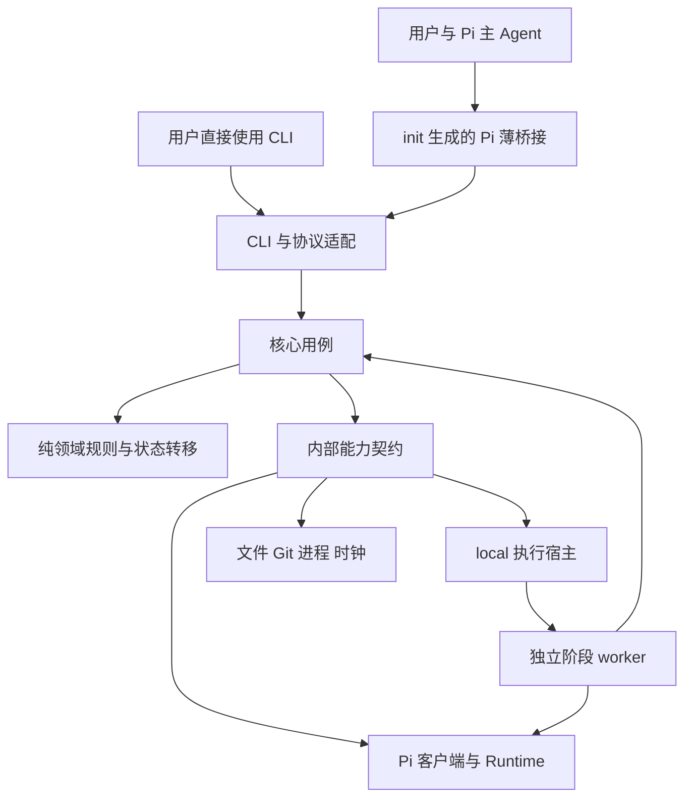

# Knit 架构设计

本文定义首版的模块、进程、数据和协议边界。产品范围见 [DESIGN.md](DESIGN.md)，状态规则见 [STATES.md](STATES.md)，技术选择见 [TECHNOLOGY.md](TECHNOLOGY.md)。以下为当前实现边界；Linux 候选已通过任务025，macOS 后续验证。

## 1. 产品与执行边界

日常由用户在 Pi 对话，主 Agent 调用 Knit。Knit 独立安装并提供 CLI；`init` 在当前项目生成薄 Pi 桥接，用户不另装全局 Pi Extension。主会话与阶段 Agent 都使用原生会话，Knit 负责协调和保存关联。

首版面向同一用户、本机原地执行。代码阶段与 Git 收尾串行，讨论、纯记录及规范候选可并行保存。内部模块可替换，源码装配表负责接入 Pi、local 和测试用 fake；不提供外部插件 SDK。Worktree、REX 和其他客户端具体实现仍属后续。

## 2. 分层与依赖



| 层 | 负责 | 约束 |
| --- | --- | --- |
| 入口 | CLI 解析、JSON 协议、Pi 命令／工具与事件映射 | 不决定任务是否完成 |
| 核心用例 | 初始化、任务操作、派发、结果接收、规范审阅、交付、恢复与诊断 | 读取事实后执行领域决定，通过端口产生效果 |
| 领域 | Task、修复计数、Run 请求、检查资格与操作规则 | 纯 TypeScript；不导入 Pi SDK、fs、Git 或 UI |
| 协议 | 命令、结果、文件 schema、错误码与版本 | 校验后转换为领域输入；不是对外插件 API |
| 适配 | ClientAdapter、AgentRuntime、ExecutionHost | 只处理客户端／宿主差异，不复制业务状态机 |
| 基础设施 | 仓储、锁、原子写、Git、进程、时钟、指纹和脱敏 | 返回证据和错误，不擅自推进 phase |

入口和适配依赖核心契约，领域不反向依赖具体实现。内部装配集中在 composition root；测试可替换端口，项目配置只能选择编译进包的 ID。Pi runtime 仅启动本机 CLI 并使用公开 JSON 协议，Knit 不依赖或导入 Pi SDK；init、基础查询和诊断不启动模型或加载用户项目扩展。

## 3. 核心模块

| 模块 | 职责及主要协作 |
| --- | --- |
| ProjectService | 解析项目根、兼容性与 Git 前置条件，按命令所需能力判断可执行性 |
| InitializationService | 文件所有权、计划、安装映射、模板发布、ready 和失败恢复 |
| TaskService | 输入／记录分区、ready、业务结束、adopt、改名和 phase；调用纯转移函数 |
| SessionService | 原生身份索引、关系、选择事件投影，恢复归属和路径核实 |
| ContextPlanner | 确定输入、规范／角色、来源指纹和工具策略；生成冻结 inputs 与注入计划 |
| RunCoordinator | 校验、占用、快照、启动、取消、等待与接收结果；不代替主 Agent 做语义判断 |
| CheckService | 生成成果范围和检查凭据，计算针对当前目标版本的资格 |
| StandardsService | 候选、审阅回执、正式规则与索引更新，向收尾提供机械提醒 |
| FinalizationService | 唯一 deliver 处理器、记录封存、限定提交、移动归档、收尾事实 |
| OperationService | 意图、步骤、效果核验、幂等接收、重试及显式放弃 |
| DiagnosticsService | 只读状态投影、doctor、storage、用量展示及恢复建议 |

核心只把原生工具回执、代码／文件版本引用或明确用户确认作为相应证据。模型称“测试通过”不能替代实际工具记录；工具退出成功也不能证明覆盖了全部目标。人工确认由主 Agent 按用户要求核对并记录，首版不设独立门槛命令或状态。

这些是代码职责，首版不拆成服务或独立部署。所有状态转移由同一份领域规则解释；CLI、桥接、worker 内的结果接收和恢复工具复用它。

## 4. 内部适配

| 端口 | 输入／输出 | 首版 |
| --- | --- | --- |
| ClientAdapter | 项目集成计划、原生上下文、有效分支关联、原生效果与确认 | Pi；生成桥接，主会话写入只能经运行中的原生 API |
| AgentRuntime | probe、指令准备、new/resume、历史、执行、取消、dispose；输出事件和报告 | 本机 Pi CLI／stdin-stdout RPC；实施与检查 Session 分离 |
| ExecutionHost | probe、launch、inspect；返回实例身份与定位 | local；同一 worker 程序 |
| GitPort | 状态、路径／index、提交树、提交与引用验证 | 原生 Git，argv 调用 |
| MetadataStore | Session／binding／operation 及短事务 | SQLite（Node24 内置 node:sqlite，M0 实证选定）；不双写权威镜像 |
| FileStore／LockStore | 项目正文、证据文件、执行与短时占用 | 本地文件系统；不把文件端口等同元数据后端已定 |
| ProcessPort／Clock | 进程身份、进程组、终态、心跳、单调耗时 | POSIX 实现；测试可注入 |

Pi 协议形状只出现在 Pi 适配目录。AgentRuntime 取消通过受控 CLI 的 `clear_queue`／`abort`，按公开 `toolCallId` 与稳定终态核实执行；不注入 SDK 工具包装器。外层只管理自身启动的进程与进程组，CLI 被强杀不代表工具全部终止；无法确认旧工具终态时保留占用并阻塞新执行，外部服务和脱离进程组的程序不获得自动接管或回滚保证。

## 5. 进程与运行时序

1. 项目桥接从当前 Pi 调用取得原生 Session、有效分支和实际模型，转给同一 CLI 命令处理器。用户直接 CLI 可没有主 Session；缺少的任务或模型必须显式补足。实现（任务015）：桥接登记主会话与有效选择，工具 schema 由构建期派生 JSON 提供；观察器按 run 发起方原生 ID 只读查询并按会话条目去重投递，不接收结果。
2. CLI 核心做只读预检、选定模型身份，发布不可变 request 与启动意图；request 记录任务／分支、预期需求摘要和输入计划引用，不提前宣称已冻结输入。
3. local 启动独立 worker 并确认实例；worker 原子认领 run，通过同一核心服务以自己的身份取得执行占用，重新核实前置条件，发布 inputs。正式实施在快照 ready 后才允许调用模型／写代码。占用从取得到释放均由同一执行者持有，不做 CLI 到 worker 的长锁交接。实现（任务012）：RunCoordinator 发布 request/launch，worker 以 `mkdir claim` 认领并自行取锁；implement 快照 ready 后停于 prepared，阶段执行由 013 在同一 run 内继续。实现（任务016）：快照同时保存工作区与独立 index blob；`snapshot show` 只读对照，restore 默认预览、需显式当前指纹，按路径恢复并留下 `.runtime/restores/` 记录，Task 输入改走 task update。
4. worker 只装配所选 runtime；默认优先按原客户端加载阶段原生记录并核对实际 ID／历史，旧记录缺失、损坏、不兼容或加载失败时自动新建 Session，从任务文件和当前现场续做。保留旧引用和原因，新会话可用后才更新阶段引用，新建失败不递归重试；不换客户端、不重置阶段／修复次数／累计 scope。两条路径均核实旧工具结束、落实本次模型／指令、等待稳定终态；记录变化不改本次冻结输入。
5. Pi CLI 自行保存原生记录，worker 核实位置、ID、持久化与本次原生条目范围后写终态 result；不由 worker 直接追加聊天文件或假造消息强制保存。原生引用独立报告可恢复性，不将其失败自动当作代码重跑理由；本 run 证据写入失败仍不发布完成。核心用固定的 acceptanceOperationId 复核结果、实际范围与输入，再写 check／scope／Task／binding；模型输出不直接修改这些文件。实现（任务013）：StageRunner 执行阶段并保存 result，RunAcceptanceService 复核输入／规范／scope／分支后机械推进；原生引用不可恢复只标 Session opening，结果写失败置 failed 不接收。实现（任务014）：DeliveryService 先落盘交付／归档操作，限定路径提交并核对真实 OID／范围／index 保护，封存后移动与归档提交；hook 越界与回执丢失分别保留现场和核实恢复。实现（任务017）：StageRunner 在项目锁后取得 Session 锁并写 `stage-process`，取消超时终止完整进程树；`locks`／`unlock` 以 owner token 显式核实与强解，resume 在旧阶段进程未确认结束时保持阻塞。
6. 结果接收可在 worker 内调用同一核心用例；若中断，后续 CLI 按结果与操作意图重入。收到结果不意味着自动发起下一个模型或 Git 操作，主 Agent 根据工作流与当前用户意图继续。

确定性 deliver 在首版由核心 CLI 同步执行，不另建后台任务平台。单独观察断开不等于取消；实际执行进程被终止则按操作中断核实工具／Git 结果并恢复，不承诺界面关闭后自动完成交付。

Pi run 后台执行，进度不触发模型回合。终态只投给仍匹配的原发起 Session／路径；已有继续授权且无暂停或待应用输入时可唤醒主 Agent，由它决定下一步，核心不直接派发。忙时须安全排队、不抢新输入；切会话或关闭则只保留结果供 status/resume，不开新会话代接。M0 必须用真实扩展验证轮外投递、触发回合及队列，类型存在不作证明；不成立先调整方案，不能拖到 M3A。重复通知不重复接受结果或 Git 效果。

## 6. 数据与唯一写入方

Task、规范和候选在可入库的项目目录；本机索引、运行证据、快照和诊断在 Git 忽略、私有权限的 .knit/.runtime/。原生历史在客户端管理的位置。下表的写入方是逻辑服务，不等于任意进程可绕守卫写入。TaskService 注入真实 run 仓储后，活动／收敛事实不信任命令自报；接收检查点 `runs/<run>/acceptance.json` 是操作恢复证据，不是第二业务权威。

| 数据 | 写入方 | 权威用途 |
| --- | --- | --- |
| task.md 输入、frontmatter 与记录 | TaskService | 业务目标及 status/phase/outcome/branch，记录短锁保护 |
| installation/init 清单 | InitializationService | 本机安装、文件所有权、模板与准备状态 |
| Session 元数据 | SessionService | 身份、角色、关系和原生引用；选择仅作已核实快照 |
| binding 元数据 | 核心任务／运行服务 | 位置、分支、范围、运行／检查引用、修复 ID／计数／停止原因 |
| run request/inputs | RunCoordinator／ContextPlanner | 不可变请求；取得占用后冻结输入，含固定 acceptanceOperationId |
| run launch | RunCoordinator | 启动意图、实例句柄与确认 |
| run state/result | worker | 真实准备、执行、取消与终态；result 不证明 Git 交付 |
| instructions、events | worker | 指令落实与脱敏进度，事件不代替结果 |
| scope/check | CheckService | 不可变范围和检查证据，当前适用性另行推导 |
| snapshot | 核心快照服务 | 恢复对照、覆盖范围及 ready；index 内容独立保存，逐路径恢复记录独立 |
| cancel 意图 | 核心 | 目标 run/operation 和 owner token，不做请求级路由 |
| 操作元数据 | OperationService | 步骤意图、文件／Git 效果与恢复事实 |
| standards.md | 主 Agent 经记录工具 | 未生效候选（`src/application/standards-service.ts`）；审阅回执存 `standards_reviews`，操作记录留痕 |
| 原生历史 | 运行中主会话的宿主 API／阶段 Pi CLI 自身 | Core 和 worker 不直接追加或并发改写原生文件；阶段记录在独立 native-sessions 位置跨 run 保留 |
| diagnostics JSONL（M3A） | 启用保存的执行者 | 可丢弃的排查信息，不作业务证据；M1 仅 stderr |

Session、binding、operation 的元数据实现为单一 SQLite 库（M0 同路径实证选定，比较夹具与证据见 [任务004](tasks/004-metadata-storage-decision.md) 与 [验证资料](validation/metadata-storage/README.md)）；数据库是唯一元数据权威，不再双写 JSON 镜像。run 证据和快照可保留文件，不将聊天原文复制入数据库。 新建阶段会话使用预分配的原生 ID 和稳定 native-sessions 目录；run 只引用原生起止 entry／leaf 与本次用量，不把后续追加当作旧 run 的内容。

讨论和收尾由主 Agent 完成时写操作与 Task，不伪造 worker run。binding 至少引用 confirmedInputs、scope、lastRunIds、lastCheckRunId、sessionRefs、activeFinalization，另存 repairCycleId、repairRounds、stopReason，以及至多一份 pendingInput 草案和基线／草案摘要；该草案不属于当前冻结输入。跨机只有入库 Task 时检查为 missing；Git 档案仅作历史。

## 7. 写入与恢复协议

可变关联元数据由仓储封装，实现为 SQLite 短事务（M0 实证选定）。事务同时提交 Session、binding、operation 的内部更新；Task Markdown、Git 与原生历史仍是外部效果，不能假定同一事务覆盖。任务文件受稳定 Task 短锁保护，指纹与已发布证据只按引用连接。

关键操作采用“意图先落盘 → 核验前置版本 → 应用效果 → 观察真实结果 → 步骤检查点 → 更新投影”。决定函数给出的 nextState 是候选目标，只有效果核验和回执完成后才能对外当成事实；不能先改 phase 再尝试执行。

概念契约为 decide(current, event, facts) → rejected(reason) 或 accepted(expectedVersion, nextState, effects)。状态不保存在某个常驻解释器实例里，每次命令从权威资料重建。每个外部动作之前，必须能从操作记录定位其目标、已知起点和幂等键。

- 状态决定为纯函数：当前状态、事件和已观测事实，返回允许的转移／效果计划或带原因的拒绝。函数不直接访问文件、模型或 Git。
- 数据文件原子替换不能代替事务。多文件效果在同一操作中逐步核验；中间状态显示 pending operation，不能当作最终状态继续执行。
- 已生效但检查点未写的效果，恢复时以当前内容／Git OID 核实并补记，不能再次盲目 commit、move 或 append。实现（任务019）：提交树模式／blob、路径集合与父节点是交付证据；move 按首次 archivePath 与目标 Task ID 核实；hook 越界只保留现场。
- 同一 run 按固定 acceptanceOperationId 接收，prepare/start 用既有对象 ID 幂等。requestId 可作日志关联，不成为取消对象或单独工作流。重复调用返回既有结果，不另执行。
- 已完成的证据不改写。新输入、新检查、恢复后的重跑使用新 run；指针失效不等于删除旧证据。
- 未完成的输入／Git／归档操作会阻塞相关后续动作；记录或选择冲突只影响相应对象，不用一个异常锁死全部功能。

task update 声明 clarify/change 及理由，核心只校验摘要和结构。clarify 保持早期 phase；选定目标的检查 stale 且当前为 deliver 时统一回 open/check 清 completed，change 回 discuss。运行中先存待应用，后续代码／交付先处理；只读发现外部改动只报告待同步。实现（任务018）：update／apply／close 在项目与任务锁内重读 binding 与 run 收敛事实；接收在改 Task 前写检查点，按来源／目标重入，scope／check／binding 半写入不宣称成功。

## 8. 并发和版本边界

执行占用覆盖代码阶段、Git 收尾、初始化和有效输入／正式规范修改。任务记录、候选和选择用短锁；次序为执行占用在前、短锁在后，不能持短锁等执行占用。临界区只做受控读改写，不拿任务文件锁等待模型或 Git hooks。

归档先写完整收尾记录，再在任务短锁下捕捉 seal 版本。封存中补记明确返回未保存，不自动转存或留修改。结束后按原意重试为新档案修改，不归入原提交或重开业务。归档移动、binding 与清关联按操作检查点恢复。

以报告／结论本身为正式成果的任务，把可验收正文放在显式成果文件并纳入 scope，Task 记录区只留摘要、验证和引用；不能借纯记录的排除规则免检业务产物。简短日常讨论仍可不建正式任务。

scope 按 Task 汇总已确认成果，不能在新 run 时清空。恢复须继承旧基线、已确认范围及待核实改动；本次快照只定义本次起点。补报告的 run 即使没有新改动，也不能遗漏前次已经产生的成果。

ContextPlanner 区分需求、所选指令版本、授权输出和纯记录。规范文件本身是明确输出时，旧输入取冻结版本，新内容作为成果核查，不能仅因同一路径改变就判需求实变。正式新规则是否适用于本任务须由主 Agent 明确，不能把未来规则自动追溯成当前验收条件；该决定与版本进入输入计划。

检查结论对指定输入和成果版本成立。工作提交前比较当前工作内容；工作提交后核实所选 commit 的内容和检查范围，不把后来未纳入该成果的工作区变动伪称已交付。若用户要求将新变更纳入本任务，先暂停收尾并重新确认范围／检查。

原生引用按客户端解释，模型每次按既定优先级解析并验证，未知版本不覆盖旧记录。旧记录无法恢复时可沿同一客户端新建会话，保留来源和失败原因；客户端缺失、模型不可用或旧工具状态未知不以新建会话绕过。标准角色、项目正文、原生自动加载和显式注入去重。跨目录、外部协作与自动清理不混入本轮架构。

## 9. 代码组织与协议

已按下列结构建立目录与职责README。核心用例与基础设施已逐任务落地（状态见 [TASKS.md](TASKS.md)）；开发阻塞记入 [BLOCKERS.md](BLOCKERS.md)，完整验收后才标完成：

```text
src/
  cli/                 # 命令、输出和 composition root
  contracts/           # schema、协议、错误码
  domain/              # 状态、守卫、决定函数
  application/         # 各核心用例
  ports/               # 内部能力契约
  adapters/pi/         # client、runtime、原生格式与桥接生成
  adapters/local/      # worker 启动与检查
  infrastructure/      # fs、Git、进程、时钟、指纹
  worker/              # 执行入口与事件记录
assets/templates/      # init 模板：.knit/ 项目资料、pi/extensions/knit.ts 桥接
test/                  # 根测试目录
```

取消以已确认的 run/operation ID 和执行 token 定位。prepare 先持久化 ID；持有调用的桥接或直接 CLI 入口保存 ID 后确认 start，之前无模型或项目业务副作用。确认是入口内部握手，不是人类二次许可或新增公开命令。start 响应丢失查原 ID，不重复启动。不设请求级取消协议，恢复以新 run ID／操作 token 隔离旧取消；终态与取消仍在同一短临界区裁定。

单独取消观察只结束观察；Pi 桥接执行工具取消必须另向核心持久化意图，不直接先杀掉调用进程。Git 操作取消停止未开始步骤，核实在途命令的真实结果后进入 needs_attention，已提交／已移动的事实不撤销。

CLI JSON 响应含 protocolVersion、requestId、outcome、data、reasonCode、nextActions；outcome 为 accepted/completed/blocked/needs_attention/error。业务待处理不是模型工具崩溃，桥接应展示下一步，不做无条件重试。

普通 `--json` 输出单响应，日志走 stderr；显式 `--events` 使用 JSONL，最后包含终态响应。流中断只表示观察结束。取消由独立意图落盘，不能让取消请求随被中断的等待子进程一起丢失。 这些是协议响应，与可丢弃的 events／诊断 JSONL 区分：协议只按 LF 增量解码，尾部半条响应不作成功，须按已知对象核实；不得忽略畸形帧后宣称命令完成。

所有提交操作由核心接收明确的完整目标 branch 和授权来源声明，并在 operation 保存来源定位／摘要、默认分支候选及实际目标。核心不宣称理解自然语言授权，Main Agent 负责取舍；主分支检测不授予权限。详见 OPERATIONS 的授权细则。

单条 Pi 工具 schema 与核心命令 schema 同源生成，桥接嵌入无业务代码的 JSON schema；参数到核心后再次校验。原生效果由桥接执行。关联条目保存需核实持久性，尚未落盘则待确认；上下文注入按本次生效信息核实，通知只报告投递。不能伪造原生历史来补齐能力。主 Agent 负责语义授权与取舍，程序的字段校验不能冒充它。

## 10. 开发诊断

核心用例与基础设施使用轻量可选 DiagnosticSink，默认空实现；领域函数仍无 I/O。--dev 只观察决定、摘要、状态与耗时，不启用原生客户端 HTTP debug，不改规则、模型或工具权限。

M1 本次 --dev 只传给对应调用／worker，结构化 stderr 与业务结果分离。M3A 才实现私有片段日志、Pi /knit dev on/off 当前会话布尔开关及完整通道验证；它不进入状态机。桥接不自动把诊断喂模型，普通终端合并 stderr 的边界见 OPERATIONS。

诊断字段按白名单产生，失败只报告诊断不可用，不改写业务结果。详细格式、保存与对比见 [OPERATIONS](OPERATIONS.md#6-开发者模式)。
