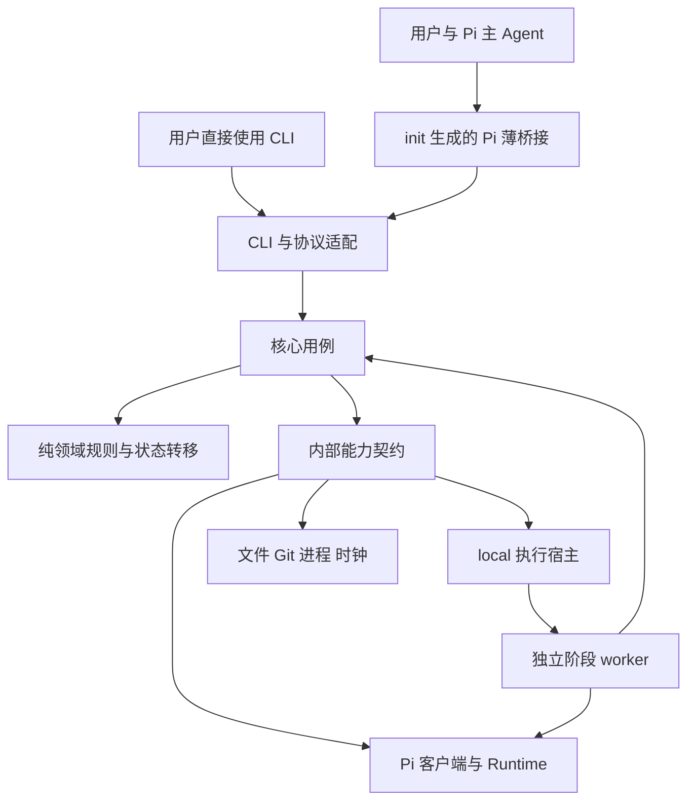

# Knit 架构设计

本文定义首版的模块、进程、数据和协议边界。产品范围见 [DESIGN.md](DESIGN.md)，状态规则见 [STATES.md](STATES.md)，技术选择见 [TECHNOLOGY.md](TECHNOLOGY.md)。以下均为待实现设计。

## 1. 产品与执行边界

日常由用户在 Pi 对话，主 Agent 调用 Knit。Knit 独立安装并提供 CLI；`init` 在当前项目生成薄 Pi 桥接，用户不另装全局 Pi Extension。主会话与阶段 Agent 都使用原生会话，Knit 负责协调和保存关联。

首版面向同一用户、本机原地执行。代码阶段与 Git 收尾串行，讨论、纯记录及规范候选可并行保存。内部模块可替换，源码装配表负责接入 Pi、local 和测试用 fake；不提供外部插件 SDK。Worktree、REX 和其他客户端具体实现仍属后续。

## 2. 分层与依赖



| 层 | 负责 | 约束 |
| --- | --- | --- |
| 入口 | CLI 解析、JSON 协议、Pi 命令／工具与事件映射 | 不决定任务是否完成 |
| 核心用例 | 初始化、任务操作、派发、结果接收、规范审阅、交付、恢复与诊断 | 读取事实后执行领域决定，通过端口产生效果 |
| 领域 | Task、WorkflowChain、Run 请求、检查资格、操作和状态规则 | 纯 TypeScript；不导入 Pi SDK、fs、Git 或 UI |
| 协议 | 命令、结果、文件 schema、错误码与版本 | 校验后转换为领域输入；不是对外插件 API |
| 适配 | ClientAdapter、AgentRuntime、ExecutionHost | 只处理客户端／宿主差异，不复制业务状态机 |
| 基础设施 | 仓储、锁、原子写、Git、进程、时钟、指纹和脱敏 | 返回证据和错误，不擅自推进 phase |

入口和适配依赖核心契约，领域不反向依赖具体实现。内部装配集中在 composition root；测试可替换端口，项目配置只能选择编译进包的 ID。Pi SDK 在所需 runtime／历史能力中延迟加载，init、基础查询与诊断不因导入 SDK 而激活项目扩展或模型。

## 3. 核心模块

| 模块 | 职责及主要协作 |
| --- | --- |
| ProjectService | 解析项目根、兼容性与 Git 前置条件，按命令所需能力判断可执行性 |
| InitializationService | 文件所有权、计划、安装映射、模板发布、ready 和失败恢复 |
| TaskService | 输入／记录分区、ready、业务结束、adopt、改名和 phase；调用纯转移函数 |
| SessionService | 原生身份索引、关系、选择事件投影，恢复归属和路径核实 |
| ContextPlanner | 确定输入、规范／角色、来源指纹和工具策略；生成冻结 inputs 与注入计划 |
| RunCoordinator | 校验、占用、快照、启动、取消、等待与接收结果；不代替主 Agent 做语义判断 |
| CheckService | 生成成果范围和检查凭据，计算针对当前目标版本的资格 |
| StandardsService | 候选、审阅回执、正式规则与索引更新，向收尾提供机械提醒 |
| FinalizationService | 唯一 deliver 处理器、记录封存、限定提交、移动归档、收尾事实 |
| OperationService | 意图、步骤、效果核验、幂等接收、重试及显式放弃 |
| DiagnosticsService | 只读状态投影、doctor、storage、用量展示及恢复建议 |

核心只把原生工具回执、代码／文件版本引用或明确用户确认作为相应证据。模型称“测试通过”不能替代实际工具记录；工具退出成功也不能证明覆盖了全部目标。检查可核部分的 verdict、当前目标的资格和任务明确要求的人工确认分别处理，默认不增加人工门槛。

这些是代码职责，首版不拆成服务或独立部署。所有状态转移由同一份领域规则解释；CLI、桥接、worker 内的结果接收和恢复工具复用它。

## 4. 内部适配

| 端口 | 输入／输出 | 首版 |
| --- | --- | --- |
| ClientAdapter | 项目集成计划、原生上下文、有效分支关联、原生效果与确认 | Pi；生成桥接，主会话写入只能经运行中的原生 API |
| AgentRuntime | probe、指令准备、new/resume、历史、执行、取消、dispose；输出事件和报告 | Pi SDK；实施与检查 Session 分离 |
| ExecutionHost | probe、launch、inspect；返回实例身份与定位 | local；同一 worker 程序 |
| GitPort | 状态、路径／index、提交树、提交与引用验证 | 原生 Git，argv 调用 |
| FileStore／LockStore | 受控读改写、单写入方文件、执行与短时占用 | 本地文件系统 |
| ProcessPort／Clock | 进程身份、进程组、终态、心跳、单调耗时 | POSIX 实现；测试可注入 |

SDK 类型只出现在 Pi 适配目录。AgentRuntime 的取消能力包括受控工具：优先通过公开 `createBashTool`／`BashOperations` 包装 shell，登记本次进程与终态；不读取私有 SDK 字段。外部服务、逃离受控进程组的守护进程不因此获得可回滚保证。

## 5. 进程与运行时序

1. 项目桥接从当前 Pi 调用取得原生 Session、有效分支和实际模型，转给同一 CLI 命令处理器。用户直接 CLI 可没有主 Session；缺少的任务或模型必须显式补足。
2. CLI 核心做只读预检、选定模型身份，发布不可变 request 与启动意图；request 记录任务／分支、预期需求摘要和输入计划引用，不提前宣称已冻结输入。
3. local 启动独立 worker 并确认实例；worker 原子认领 run，通过同一核心服务以自己的身份取得执行占用，重新核实前置条件，发布 inputs。正式实施在快照 ready 后才允许调用模型／写代码。占用从取得到释放均由同一执行者持有，不做 CLI 到 worker 的长锁交接。
4. worker 只装配所选 runtime；创建或按原客户端恢复阶段 Session，登记原生引用、落实指令、执行并等待工具终态。记录变化不改本次冻结输入。
5. worker 持久化原生会话并写终态 result。核心用固定的 acceptanceOperationId 复核结果、实际范围与输入，再写 check／scope／Task／binding；模型输出不直接修改这些文件。
6. 结果接收可在 worker 内调用同一核心用例；若中断，后续 CLI 按结果与操作意图重入。收到结果不意味着自动发起下一个模型或 Git 操作，主 Agent 根据工作流与当前用户意图继续。

Pi 日常 run 可后台返回 ID，让主会话继续讨论。桥接可观察事件并用工具进度展示；终态可通过原生消息提醒原发起主会话。进度不触发模型轮次，提醒不执行下一阶段。只有当前原生 Session／有效路径仍匹配发起上下文时才自动投递；不能把旧结果塞进后来切到的会话或覆盖当前任务选择。重复通知只重查事实，不重复接受结果或 Git 效果。重开 Pi 后由 status/resume 恢复，不依赖旧监听器。

## 6. 数据与唯一写入方

所有本机文件都在 Git 忽略、私有权限的 `.knit/.runtime/` 中。下表的写入方是逻辑角色，同一核心服务可运行于不同 CLI／worker 进程，但写入必须经过同一守卫和占用。

| 文件／数据 | 写入方 | 权威用途 |
| --- | --- | --- |
| task.md 输入及 frontmatter | TaskService | 业务目标与 status/phase/outcome/branch；记录区另受短锁保护 |
| installation.json、init-manifest.json | InitializationService | 本机安装、文件所有权、模板与初始化状态 |
| sessions/*.json | SessionService | 身份关系；selectedTaskId 是有效原生路径的已核实投影 |
| bindings/*.json | 核心任务／运行服务 | 本机路径、分支、Session、范围／检查引用、当前链与收尾引用 |
| runs/*/request.json | RunCoordinator，发布后不改 | run、purpose、模型、cwd、工具、恢复意图、acceptanceOperationId |
| runs/*/inputs.json | worker 内的核心 ContextPlanner，发布后不改 | 取得占用后冻结输入原文／引用及指纹，不随记录区更新 |
| runs/*/launch.json | RunCoordinator | 启动步骤、实例句柄和响应是否确认 |
| runs/*/state.json | worker | 认领、准备、运行、取消和执行终态，含版本／实例证据 |
| runs/*/instructions.json | worker | 本次实际指令来源、途径与可确认生效信息 |
| runs/*/result.json | worker，终态不改 | 执行报告、原生引用和增量用量；不是 Git 交付证明 |
| runs/*/scope.json、check.json | CheckService | 已确认成果范围／检查证据；发布后不改 |
| runs/*/events.jsonl | worker | 进度和脱敏事件，不能代替状态／终态回执 |
| runs/*/snapshot/ | 核心快照服务 | 恢复对照与 ready 证据 |
| cancel.request | 核心 | 幂等取消意图，run 及 owner token 固定 |
| operations/*.json | OperationService | 状态迁移、请求级取消、文件／Git 效果和幂等恢复事实 |
| standards.md | 主 Agent 经核心记录工具 | 未生效候选；对应审阅事实在操作回执 |
| 原生 Session 文件 | 主会话桥接或阶段 runtime 的原生 API | 对话、工具和分支关联；Core 不直接并发改写活跃原生文件 |

讨论和收尾由主 Agent 完成时写核心操作及任务记录，不伪造 worker run/result。advisory worker 的 result 只证明建议已产出。worker 崩溃后核心可在 run.reconcile 操作中确认 failed/cancelled，不能伪写 completed 的 worker 报告。

binding 至少引用 confirmedInputs、scope、lastRunIds、lastCheckRunId、sessionRefs、chain、activeFinalization。引用缺失时按 Task、run 和操作回执核对，不能从正文猜通过。跨机只有入库 Task 时，本机检查资格为 missing。

## 7. 写入与恢复协议

可变元数据按 Task、Session、Init 和 Operation 聚合，尽量在各自单文件内原子替换；同一 Task 的受控文件与 binding 通过稳定 Task 短锁串行读改写。指纹、已发布报告和范围按引用连接，不把一份事实复制成多套可写状态。

关键操作采用“意图先落盘 → 核验前置版本 → 应用效果 → 观察真实结果 → 步骤检查点 → 更新投影”。决定函数的 nextState 是待实现目标，只有效果核验和回执完成后才能对外当成事实；不能先改 phase 再尝试执行。

概念契约为 decide(current, event, facts) → rejected(reason) 或 accepted(expectedVersion, nextState, effects)。状态不保存在某个常驻解释器实例里，每次命令从权威资料重建。每个外部动作之前，必须能从操作记录定位其目标、已知起点和幂等键。

- 状态决定为纯函数：当前状态、事件和已观测事实，返回允许的转移／效果计划或带原因的拒绝。函数不直接访问文件、模型或 Git。
- 数据文件原子替换不能代替事务。多文件效果在同一操作中逐步核验；中间状态显示 pending operation，不能当作最终状态继续执行。
- 已生效但检查点未写的效果，恢复时以当前内容／Git OID 核实并补记，不能再次盲目 commit、move 或 append。
- 同一 run 接收结果使用 request 中固定的 acceptanceOperationId；同一用户请求由桥接带稳定 requestId。重复请求返回已知结果或恢复同一操作。
- 已完成的证据不改写。新输入、新检查、恢复后的重跑使用新 run；指针失效不等于删除旧证据。
- 未完成的输入／Git／归档操作会阻塞相关后续动作；记录或选择冲突只影响相应对象，不用一个异常锁死全部功能。

task update 在活动 run 中可先保存待应用输入操作，不改当前有效输入。当前 run 继续旧范围或明确取消；新代码阶段和交付必须先应用或明确撤回该待应用变更。纯记录不用进入此流程。

## 8. 并发和版本边界

执行占用覆盖代码阶段、Git 收尾、初始化和有效输入／正式规范修改。任务记录、候选和选择用短锁；次序为执行占用在前、短锁在后，不能持短锁等执行占用。临界区只做受控读改写，不拿任务文件锁等待模型或 Git hooks。

归档先写完整收尾记录，再在任务短锁下捕捉 seal 版本。封存后的补记返回后续处理；本次归档不能声称包含后来内容。归档移动、binding 与清关联按操作检查点恢复。

以报告／结论本身为正式成果的任务，把可验收正文放在显式成果文件并纳入 scope，Task 记录区只留摘要、验证和引用；不能借纯记录的排除规则免检业务产物。简短日常讨论仍可不建正式任务。

scope 按 Task 汇总已确认成果，不能在新 run 时清空。恢复须继承旧基线、已确认范围及待核实改动；本次快照只定义本次起点。补报告的 run 即使没有新改动，也不能遗漏前次已经产生的成果。

ContextPlanner 区分需求、所选指令版本、授权输出和纯记录。规范文件本身是明确输出时，旧输入取冻结版本，新内容作为成果核查，不能仅因同一路径改变就判需求实变。正式新规则是否适用于本任务须由主 Agent 明确，不能把未来规则自动追溯成当前验收条件；该决定与版本进入输入计划。

检查结论对指定输入和成果版本成立。工作提交前比较当前工作内容；工作提交后核实所选 commit 的内容和检查范围，不把后来未纳入该成果的工作区变动伪称已交付。若用户要求将新变更纳入本任务，先暂停收尾并重新确认范围／检查。

原生引用按客户端解释，模型每次按既定优先级解析并验证，未知版本不降级覆盖。标准角色、项目正文、原生自动加载和显式注入去重。跨目录、外部协作与自动清理不混入本轮架构。

## 9. 代码组织与协议

建议实现目录如下，当前尚未创建：

```text
src/
  cli/                 # 命令、输出和 composition root
  contracts/           # schema、协议、错误码
  domain/              # 状态、守卫、决定函数
  application/         # 各核心用例
  ports/               # 内部能力契约
  adapters/pi/         # client、runtime、原生格式与桥接生成
  adapters/local/      # worker 启动与检查
  infrastructure/      # fs、Git、进程、时钟、指纹
  worker/              # 执行入口与事件记录
assets/pi/             # 生成到用户项目的薄桥接模板
test/                  # 根测试目录
```

取消以原调用 requestId 定位当前尝试，目标尚未分配 ID 时也先在操作日志保存意图。目标出现后转发到 run 的 cancel.request 或确定性操作；每个有副作用的步骤开始前重核。新恢复尝试使用新 requestId，不让迟到的取消误伤它。worker 的终态裁定与取消请求在同一短临界区排序，包含 finalizing 时收到取消的情况。

单独取消观察只结束观察；Pi 执行工具取消必须另向核心持久化意图，不直接先杀掉调用进程。Git 操作取消停止未开始步骤，核实在途命令的真实结果后进入 needs_attention，已提交／已移动的事实不撤销。

CLI JSON 响应含 protocolVersion、requestId、outcome、data、reasonCode、nextActions；outcome 为 accepted/completed/blocked/needs_attention/error。业务待处理不是模型工具崩溃，桥接应展示下一步，不做无条件重试。

普通 `--json` 输出单响应，日志走 stderr；显式 `--events` 使用 JSONL，最后包含终态响应。流中断只表示观察结束。取消由独立意图落盘，不能让取消请求随被中断的等待子进程一起丢失。

单条 Pi 工具 schema 与核心命令 schema 同源生成，桥接嵌入无业务代码的 JSON schema；参数到核心后再次校验。原生效果由桥接执行。关联条目保存需核实持久性，尚未落盘则待确认；上下文注入按本次生效信息核实，通知只报告投递。不能伪造原生历史来补齐能力。主 Agent 负责语义授权与取舍，程序的字段校验不能冒充它。
