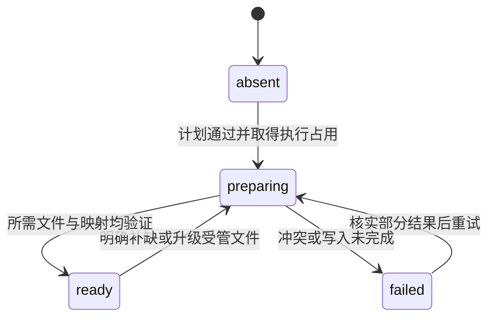
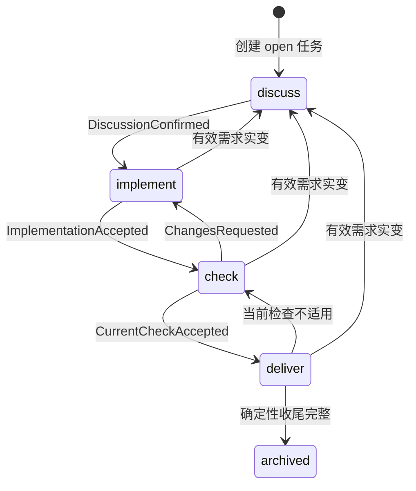
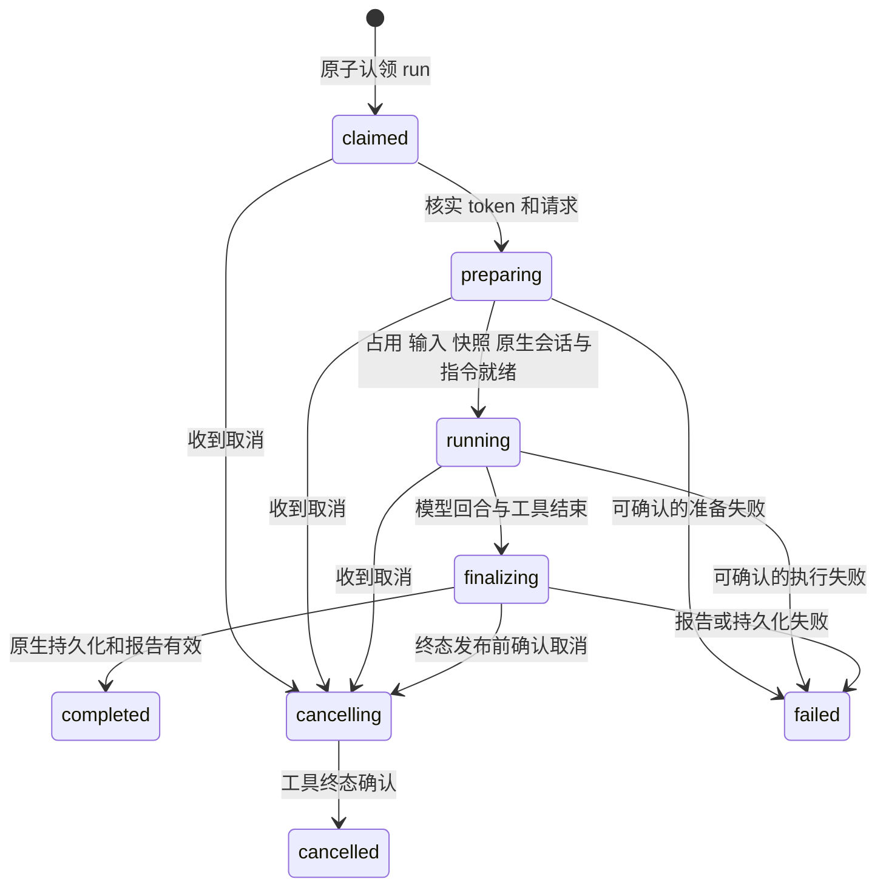
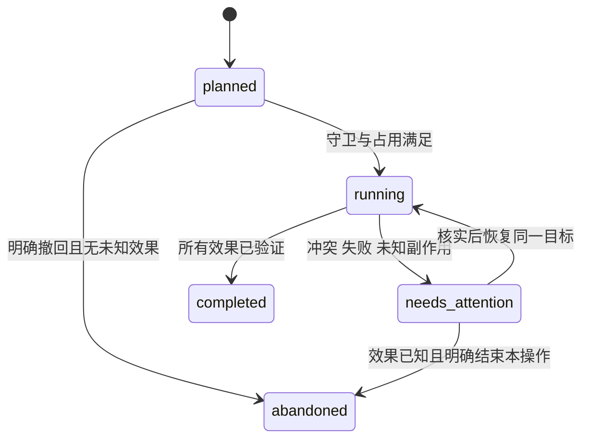

# Knit 状态与转移

本文件是首版状态契约，配合 [架构](ARCHITECTURE.md)、[产品规范](DESIGN.md) 和 [运行细则](OPERATIONS.md) 阅读。所有运行行为待实现；下列枚举、事件、守卫与恢复路径用于代码和测试。

## 1. 建模规则与状态目录

状态分三类：持久状态可按事件修改；不可变证据发布后不改；观察／展示由证据推导，不另建一个可写的“总状态”。Task phase 表示下一项业务工作，不能充当 worker 或 Git 进度。

| 对象 | 持久状态／权威 | 写入方 | 观察与展示 |
| --- | --- | --- | --- |
| 初始化 | init-manifest：preparing/ready/failed；无文件为 absent | 初始化用例 | ready 之外仍核对实际文件和兼容性 |
| 初始化文件步骤 | planned/applied/verified、冲突原因，保留尝试记录 | 初始化用例 | missing、unchanged、conflict 是实际检查结论 |
| Task | task.md：status、phase、outcome、branch | 核心 TaskService | 运行中、待检查、待规范、待收尾、已归档等派生 |
| 自动执行链 | binding.chain：active/paused/finished，次数与原因 | 核心协调用例 | 只限制同一授权链，不是后台调度器 |
| 启动 | launch.json：planned/starting/confirmed/failed | 核心启动用例 | 未确认、响应丢失结合 worker 实例核实 |
| worker | state/result：claimed/preparing/running/finalizing/cancelling，及 completed/failed/cancelled | worker | 整体 requested、unknown、conflict 由核心推导 |
| 取消 | cancel.request；worker acknowledgement 与终态 | 核心／worker 各写自己的文件 | requested、acknowledged、unconfirmed、confirmed |
| Session | 索引身份、原生引用与来源 | 核心 SessionService | opening/available/missing/incompatible 等可用性 |
| 活动选择 | 原生有效路径的选择事件，索引为投影 | 桥接持久化，核心解释 | none/active/suspended/history_only |
| 成果范围／检查 | scope.json、check.json，不可变 | 核心 CheckService | missing/pending/valid/stale/blocked |
| 人工验收门槛 | 输入中明确要求的条目 + acceptance.confirm 操作证据 | 核心验收用例 | pending/confirmed/obsolete；默认无此门槛 |
| 规范审阅 | 候选文件 + 当前版本的审阅回执 | 核心记录用例 | absent/pending/reviewed/stale；决定另列 |
| 操作 | operations：planned/running/needs_attention/completed/abandoned | 核心 OperationService | 每步按真实文件／Git 效果核验 |
| 收尾封存 | delivery 操作的 seal 及版本 | 核心收尾用例 | open/sealed/archived；binding 只保存引用 |
| 快照 | snapshot/manifest：preparing/ready/failed | 核心快照用例 | 仅 ready 可作为恢复对照 |
| 占用 | 锁目录与 owner token | 持有者与核实后的恢复用例 | free/held/suspect/unknown/reclaimable |
| 桥接／观察者 | 内存 attached/observing/disconnected/stopped；安装映射另存 | 主客户端适配 | 监听器退出不改变 worker 状态 |
| 实现实例 | 内存 created/ready/in_use/disposing/disposed | 装配与进程所有者 | 构造失败清理已取得资源，不建立持久插件状态 |
| 数据兼容性 | 文件中的版本，不能擅改 | 对应写入方 | supported/migration_required/unsupported/corrupt |

诊断派生值不能覆盖原事实。例如检查文件中的 pass 不变，当前目标变化只使其资格 stale；心跳可疑不把 worker 写成 failed。每个转移处理必须记录事件来源、预期版本、允许动作、效果及核验结果。

## 2. 初始化

| 事件 | 守卫与动作 | 失败／恢复 |
| --- | --- | --- |
| InitChecked | 只读计划，不变状态 | 冲突列差异；不执行模型、依赖安装或 Git 初始化 |
| InitStarted | schema 可识别、文件所有权已知、无冲突写入；取得项目执行占用，先写 preparing | 预检拒绝且未写入时不伪造一次初始化成功或失败 |
| ArtifactApplied | 项目资料只补缺；受管桥接／入口对照旧基线，原子写候选并核验 | 当前不等于 before/after 均视为冲突，不覆盖 |
| InitPublished | 全部必需文件、版本、私有映射匹配，发布桥接后 ready | 中间失败保留逐项结果，桥接拒绝处理未 ready 实例 |
| ArtifactChangedExternally | manifest 不改成假 failed，健康视图指出冲突／缺失 | init 核实后补缺，已修改的项目正文不重置 |

ready 是初始化完成事实，不证明所有命令前置条件成立。非 Git 项目可 ready；正式代码／提交仍要求有效 HEAD 和分支。CLI 查询不要求 Pi 或桥接已运行。未知版本只读显示，不猜测迁移。

## 3. Task 业务状态

合法组合：open 时无 outcome；closed 必有 completed/cancelled/superseded。closed/completed 的 phase 为 deliver；取消／替代保留停止位置。业务结束与提交归档完成分别判断。

图中 archived 为展示，字段不增加第五个 phase。所有未归档阶段均可在工具终态核实后 closed/cancelled 或 closed/superseded。换机器只有 Git 归档资料时，核实文件已入库、ID 与结束字段后显示“Git 历史已归档、无本机执行凭据”，不自动重开，也不把它当新交付的检查证明。

| 事件 | 前置条件 | 业务转移与效果 |
| --- | --- | --- |
| TaskCreated | 用户已授权创建，当前任务身份唯一 | open/discuss，保存当前分支，不自动实施 |
| DiscussionConfirmed | 主 Agent／用户明确输入可实施，必需资料齐全 | discuss → implement；记录确认的输入引用，不以模型建议代替确认 |
| InputsUpdateProposed | 有效输入变更，活动 run 尚未停 | 保存待应用操作，不修改有效输入；阻止后续代码阶段和交付，记录仍可写 |
| InputsUpdated | 已取得执行占用、无未知工具，当前版本匹配 | open/discuss，清 completed 与旧检查资格；可随后明确确认到 implement |
| RecordWritten | 记录区或未生效候选、任务短锁、未封存 | status/phase/outcome 和有效输入均不变 |
| ImplementationAccepted | execution run 正常结束、报告与实际范围有效、无执行阻塞 | implement → check，保存 scope 引用 |
| CheckAccepted | 本次最新检查、输入／目标版本匹配、必需条件有证据 | pass → deliver；changes_requested → implement；blocked 保留 check 与原因 |
| RecheckRequested | 明确复查，未完整归档且相关收尾已核实处理 | deliver 或未归档 completed → open/check，保留范围与历史，不重聊需求 |
| BusinessClosed | completed 需要有效检查及主 Agent 完成判断 | closed/completed/deliver；不等于 Git 交付完成 |
| TaskEndRequested | 明确取消／替代；若仍运行先请求停止并等待确认 | 工具终态后 closed，相应 outcome，phase 保留停止位置 |
| DeliveryCompleted | 收尾操作 completed，必要文件／Git 证据均核实 | 展示已归档及实际 outcome，结束该任务活动关联 |
| NewBusinessChangeBeforeArchive | 归档未完成且明确新业务要求 | 清 completed，回 open 及相应阶段；已发生提交保留并按事实处理 |

DiscussionConfirmed 对应 `task ready`，由主 Agent 在自然对话确认后代调；也可由明确的 ready+run 组合请求触发，仍需先落确认事实。程序检查结构和证据，主 Agent负责语义授权与取舍。

adopt 不切换 Git 分支，未核实的 Git／归档效果先处理。无活动／未知 run、任务与仓库一致且有效需求未变：discuss/implement 保持，check 待重查，deliver 回 open/check 并清 completed。检查证据留历史，原 Session 通过新分支上下文核实后可用。取消／替代只接管收尾，完整归档不自动重开；输入不同按 InputsUpdated，不凭本机旧 phase 覆盖当前文件。

## 4. 自动执行链

| 当前 | 事件／条件 | 下一状态与效果 |
| --- | --- | --- |
| 无链／finished | 明确开始新的授权工作 | active，生成新 ID 与次数 0 |
| active | 正常阶段结束，范围和授权未变 | active；主 Agent 可按工作流继续，核心不自行启动新模型 |
| active | 开始一轮自动修复 | 核实未达上限后计数；重查不重复计一轮 |
| active | 达上限、阻塞、用户停止后续衔接 | paused，记录原因，不自动重置后重试 |
| paused | 普通中断恢复且未要求新修复周期 | 沿用原次数；原上限仍约束 |
| paused | 用户明确开启新修复周期／新范围 | 旧链结束，新链 active；保留关系，不借内部 retry 重置 |
| active／paused | 完整交付或业务取消／替代收妥 | finished |

取消已经完成的 run 不撤销结果，但应阻止该链继续自动启动下一阶段。范围改变、暂停和当前选择变化不能改掉旧 run 的任务身份。

## 5. 启动与 worker

### 5.1 启动意图

| 当前 | 事件 | 动作与下一状态 |
| --- | --- | --- |
| 无 request | RunRequested | 只读预检后发布不可变 request 和预期输入引用，launch=planned；实际冻结在 worker 取得占用后 |
| planned | LaunchStarted | 先 starting，再调用 host.launch；OS 进程启动不等于 Agent 已开始 |
| starting | LaunchConfirmed | 保存句柄和实例证据 → confirmed；worker 随后自己取得执行占用、准备快照与输入 |
| starting | 调用响应丢失 | 不重启；观察匹配 request 的 worker 和宿主实例 |
| planned／starting | 确认没有产生运行且调用失败 | failed，记录原因后释放本次已取得占用 |
| 任意未终结 | 发现已认领的同 run worker | 采用原实例补定位；不能启动第二个 |

launch 已 confirmed 不证明 worker 完成；旧句柄也不证明仍活着。无法证明有无实例时整体视图为 unknown，禁止重启。

### 5.2 worker 生命周期

terminal result 先持久化，state 再收敛终态；均由该 worker 写入，终态不覆写。Pi 的 agent_end 可能位于 SDK 自动重试之间，不能单独作为终态；按公开 prompt 完成／agent_settled 和实际工具终态进入 finalizing。completed 只表示执行结束，不直接决定 Task 或 Git 结果。

失败／取消必须保存实际部分结果。进程突然消失而工具不明时不能制造终态；核心记录 run.reconcile 操作，经实例和工具核实后只能补充 failed/cancelled 的恢复结论，不伪造成功报告。正常结果的 phase 接收通过 request 中固定 acceptanceOperationId 幂等执行。

### 5.3 整体 run 展示

优先级：证据冲突 → conflict；有效终态与工具确认 → 对应终态；活跃实例 → preparing/running/cancelling；仅启动意图 → requested/launching；无法核实 → unknown。结果已写但接收未完成时显示“执行已结束、状态待同步”，先恢复固定接收操作，不重复实施。阶段可继续的提醒在接收和占用收妥后发出，不能只看 result 文件出现。

### 5.4 桥接与观察者

| 事件 | 转移与边界 |
| --- | --- |
| 模板、安装映射与原生 API 可用 | attached，可提供上下文和工具，不要求已有 worker |
| run 启动或重连已有 run | observing，只观察，不生成第二个 worker |
| 原生会话／分支切换 | 重算选择与通知范围；不向新的无关上下文自动投递旧结果 |
| 观察流断开 | disconnected，保留 run；可由状态和日志重连 |
| reload／dispose／Pi 退出 | stopped，关闭观察资源；不据此取消后台 worker |

明确取消执行动作才向核心另写 cancel；取消单独的观察或关闭 CLI 等待仅停止观察。重复提醒不重复接受结果或推进阶段。

## 6. 取消

请求以调用 requestId 定位当前尝试；目标 ID 尚未产生时在操作日志先保存意图，副作用前重核。目标绑定后转发 run.cancel.request 或确定性操作，不按当前选择猜目标。恢复的新尝试有新 requestId，迟到的取消不能误伤它。

### 6.1 worker 取消

取消意图以 runId、requestId、owner token 固定。重复请求返回相同意图，不能指向恢复后新 run。worker 确认后进入 cancelling，停止新模型／工具动作，等待已知工具结束；30 秒宽限到期只显示 unconfirmed，保留占用。

若终态先发布，返回已经结束，不覆写结果；若取消先持久化，在包括 finalizing 的同一短临界区裁定取消，不能靠 mtime 或模型文字猜顺序。停止链仍需核实链 ID，不影响后来新开的链。未知工具仍存活时不得启动另一代码阶段。

关闭 CLI 等待仅结束观察。Pi 的执行工具取消另向核心请求，不能先把调用进程杀掉；单独 status --events 的取消只停止观察。

### 6.2 确定性操作取消

取消提交／归档／初始化／恢复操作，先保存意图，停止未开始步骤并核实在途进程。已有 commit/move 或部分文件效果如实保留，进入 needs_attention（reason=cancelled），不自动回滚，不将任务 outcome 改为 cancelled。工具未知时保留执行占用；确认结束后释放，后续 resume --operation 使用新请求尝试并跳过已验证步骤。取消意图已转达不等于目标已停止。

## 7. Session 与选择

| 事件 | 身份／可用性转移 |
| --- | --- |
| 分配 Knit Session ID | opening，可尚无原生引用，不能声称可恢复 |
| 原生打开／创建且持久性已核实 | available，补齐客户端、定位、角色和关系；binding 只引用已确认的可恢复记录 |
| 有分配引用但尚不能核实落盘 | pending_persistence，保留引用和待确认效果，不宣称可恢复，不伪造消息触发保存 |
| 创建尝试失败且从未取得引用 | not_created，只保留尝试，不把预分配 ID 当可恢复会话 |
| 恢复 | 先取得 Session 执行占用，核实旧工具结束，再由原客户端 open；新 run 不改旧引用 |
| 文件缺失／版本或角色不匹配 | missing/incompatible/needs_verification；保留引用，不改用其他客户端 |
| 明确 new／切换客户端 | 新 Session 与来源关系，旧记录保留 |
| SDK dispose | 原生文件仍可 available；实例释放不表示会话被删除 |

worker 不能复用活跃主会话文件作为阶段 Session。恢复旧 Session 时 opening 属于本次尝试，不抹掉其原有引用；not_created 不覆盖旧的可用阶段 Session。内部实例的 dispose 不删除原生记录。

选择事件由核心决定，Pi 桥接在本次有效分支写专用条目，随后核心确认。步骤为计划、重核原生上下文、追加事件、原生确认、更新索引。追加后响应丢失时按 operationId 查已有条目；不得重复追加或并发编辑活跃原生文件。

原生选择条目已持久化后才确认该保存步骤，未能核实时为待确认；单独通知不承担此持久化义务。当前有效路径最后一个匹配项目的选择事件决定投影；taskId=null 是清除，不能回退复活早期选择。路径或 Git 分支改变重新核实：可执行／待收尾为 active，暂不匹配为 suspended，完整归档为 history_only，无事件为 none。归档只结束同 Task 关联，不清掉后来选的别的任务。

## 8. 检查资格

check.json 的 verdict 与范围是不可变证据，资格针对目标版本实时推导。lastCheckRunId 在检查取得占用并获准执行时更新；未获准的忙请求不算一次已开始检查，获准后的准备／执行失败则不能回退更早 pass。Task 范围累积，不随恢复的新 run 起点清空；若规范文件本身为已授权输出，冻结输入与新成果分开，按主 Agent 明确的适用决定选择版本，不能自动追加新验收条件。

| 情况 | 资格与动作 |
| --- | --- |
| 无本机证据、scope 无法重建 | missing，要求明确范围并检查，不凭 phase 通过 |
| 最新 check 尚在运行 | pending，不能用更早 pass 收尾 |
| 最新报告 pass，身份／输入／成果匹配，必需人工项已确认 | valid，可进入收尾 |
| 技术检查 pass，但明确必需的人工项尚未确认 | blocked（waiting_human），保留技术证据，不重跑模型来代替用户确认 |
| 最新 changes_requested/blocked，或必需项未验证 | blocked，修复／补证据 |
| 业务输入、已选规范、源码、分支或 restore 变化 | stale，重新核对；旧结论仅对原版本成立 |
| 纯记录、运行引用、未生效候选、metadata phase 变化 | 资格不变 |
| Task 等价改名／归档移动 | 按 Task ID 与任务内相对路径重定位，核实操作后资格不变 |

工作提交后按选定 work commit 的内容核对资格，不因后来无关工作区变动声称该变动已交付。将新变动纳入本任务需重新确认范围。重复接收同 run 不重复写凭据、计修复次数或推进 phase。

输入确认时仅记录用户明确要求的 requiredHumanConditions，默认空，框架不额外加审批。检查 verdict 表示角色可验证部分的结论，人工条件列出待确认 ID，不能伪报完成。task accept 记录当前 Task、输入和成果版本的明确用户确认；条件／版本变化后确认 obsolete。基础技术 verdict 必须 pass，不能用人工一句话绕过 changes_requested 或真实 blocked。人工门槛齐备后重算资格即可，不为补一个确认重新调用模型；语义与授权由主 Agent 负责，核心验证来源和版本。

## 9. 规范候选

| 事实 | 展示／动作 |
| --- | --- |
| 无 standards.md | absent，收尾记未发现候选，不强制新增 |
| 有候选，无匹配回执 | pending，机械提示主 Agent 审阅 |
| 回执与 Task、分支、候选摘要匹配 | reviewed，可继续；决定为 applied/deferred/rejected/mixed |
| 候选内容或绑定分支改变 | stale，重新提示，不借旧的“看过了”跳过 |

延期或拒绝要有理由，允许正常交付；采纳需记录正式规范引用，并在已有授权内更新正文和索引。实际规则变化另由输入／检查规则处理，不能把候选自动加成本次验收条件。规则以后再次变化，不撤销“当时已处理”的历史事实。

## 10. 操作与步骤

步骤尝试记录 started/applied/verified 或 failed，旧尝试不删；failed 是尝试结果，不等于可以盲目从头再来。恢复规则如下：

| 实际证据 | 处理 |
| --- | --- |
| 仍为预期 before | 可按授权继续该效果 |
| 已为预期 after | 补验证检查点，跳过重复效果 |
| 前后都不匹配 | needs_attention，保留新内容，不能覆盖 |
| Git／进程效果未知 | 先核实；无证据不重试或放弃 |
| 只有记录／选择冲突 | 只阻相关对象；其他合法阶段不因它全局卡死 |
| 已有待应用有效输入或未核实 Git 效果 | 阻后续代码／交付，先处理或明确撤回 |

completed/abandoned 不重写为运行中。新目标使用新操作并关联旧事实；放弃不撤销已存在的 commit/move，不自动 reset/amend。普通 doctor 只报告；resume --operation 明确恢复该操作，不偷偷启动模型。需要修复时先形成限定范围计划，按相同日志与守卫执行。

## 11. 收尾与封存

`deliver` 是唯一收尾处理器，`run deliver` 转发它，`assist deliver` 只创建 advisory run。

| 步骤 | 效果与完成证据 |
| --- | --- |
| preflight | Task／分支／授权、无未知工具、当前候选审阅满足；正常 completed 交付另需检查资格，取消／替代仅归档资料 |
| work_commit | 正常交付冻结候选路径／目标树并限定提交，核实 commit 和 index；无成果或仅取消归档时跳过并记原因 |
| prepare_archive | 把结果、验证、work commit 与业务结束写进记录／元数据，再次核对候选及输入 |
| seal_archive | 短锁内固定任务记录版本、目录、引用计划和首次归档月份 |
| move_task | 移动与逐文件指纹匹配；部分状态核实后补记，不能另建同 ID 草稿 |
| archive_commit | 只提交本任务路径与预定引用，核实真实树与 OID，不把自身哈希写回该 commit |
| finalize | 更新定位和历史关系、按条件清活动选择、操作 completed，展示实际结束结果 |

检查结论只用于正常完成交付。closed/cancelled 或 superseded 的资料归档，不要求把未完代码检查成 pass，也不默认提交部分源码；封存实际结果、未提交改动／恢复引用并归档资料。有意义的工作提交已存在则引用它，没有则明确记录无工作提交，不造空 commit。

收尾结果分别报告工作提交、移动、归档提交、待办，不能用 closed 或目录存在代替整体验证。重试沿用操作及首次目标；hook 或外部改动改变预期树时 needs_attention，不自动改历史。

封存前记录可保存；封存后只允许本操作已计划的效果，新的补记返回后续处理。工具已终止且尚未移动时可明确解除封存、重新准备；已移动或提交结果不明时先恢复／核实该操作，不能直接放开并发写。需要改变业务目标时暂停收尾并做明确修复，不自动撤销 Git。

## 12. 快照、占用与兼容

快照 preparing → ready 或 failed；失败不能调用阶段模型／开始写代码。可信 worker 程序可以先启动并取得占用来准备快照，不做跨进程占用交接。ready 不代表代码没改过，只证明起点已保存。restore 是独立操作：预览不改文件，执行需期望当前指纹、占用及工具终态；恢复后旧检查对新目标不再有效。

Task 管理文件保存起点用于对照，不能把整份旧 task.md 还原覆盖后来记录和状态。输入恢复经 task update 保留当前记录；runtime、索引和原生 Session 不由通用源码 restore 覆盖。快照一致性只冻结业务输入和成果起点，允许的纯记录更新不使准备失败。

占用通过本地原子 mkdir 获取，held → release 必须匹配 token；执行占用还需工具终态，短锁只保护读改写。心跳可疑只得到 suspect，身份无法核实为 unknown；同机器和实例证据证明终止后才 reclaimable。人工强解是显式风险操作与审计，不证明外部工具结束；旧 token 不得写回业务状态。

兼容性 supported 允许按命令守卫运行；已知旧版需明确迁移路径；未知新版／损坏只读报告。首版没有历史迁移器，不用字段猜测代替迁移。内部资源释放不删除原生文件、检查或回执，首版不自动 gc。

## 13. 命令与状态入口

| 入口 | 主要事件／边界 |
| --- | --- |
| init | InitChecked/InitStarted/InitPublished |
| task new/ready/update/record/adopt/close | 对应 Task 事件；ready 是语义确认，record 不改输入 |
| task accept --condition | 仅确认输入已明确要求的人工条目，不能自动新增门槛或替代技术检查 |
| run discuss / context | 只提供讨论输入与下一步，由主 Agent 对话，不伪造 worker run |
| run implement/check | RunRequested；正常结果经固定接收操作成为 Task 事件 |
| assist discuss/deliver | advisory run，不能触发 Git 或业务完成 |
| deliver / run deliver / archive | 同一收尾与步骤恢复，不另建完成路径 |
| cancel --run / --operation / --request | 取消指定当前尝试，不按选择推断；停止执行与业务结束分别处理 |
| resume --run | 核实原实例终态后新 run，保持所属客户端与链计数 |
| resume --operation | 核实同操作效果，再继续步骤，不先重跑 worker |
| standards propose/review | 候选版本与审阅事实，采纳影响输入时按输入守卫处理 |
| snapshot show/restore/unlock | 只读对照或明确有副作用动作，不能自动越过终态与指纹 |
| doctor/status/storage | 派生展示，不推进任何业务状态 |

每个事件需测试正常、拒绝、重复、崩溃后恢复；至少覆盖桥接失联、原生分支变化、记录并发、adopt、最新检查失效、候选变更、取消与完成竞争、commit 成功但回执丢失、移动后中断和未知锁。验收应断言下一步允许做什么，而不仅断言状态字符串。
