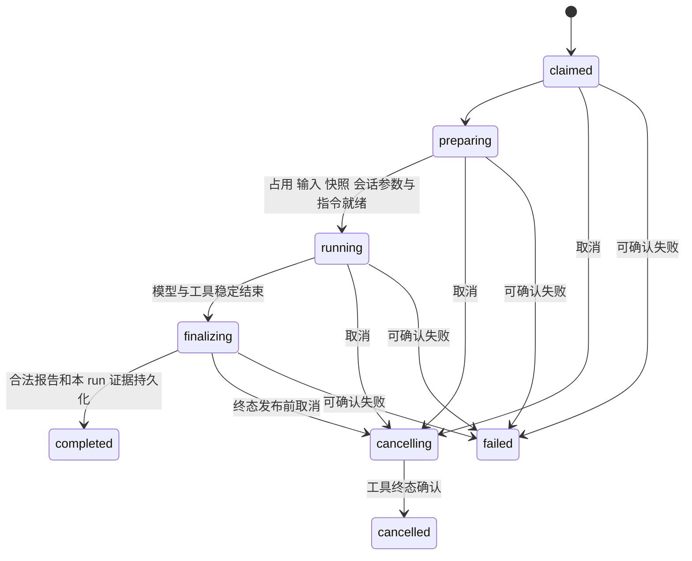

# Knit 状态与转移

本文定义首版需要持久化的业务状态和执行协议；架构见 [ARCHITECTURE.md](ARCHITECTURE.md)，操作细则见 [OPERATIONS.md](OPERATIONS.md)。当前均为待实现设计。元数据物理实现已定为单一 SQLite 库（M0 实证），不改变这里的权威与守卫。

## 1. 状态边界

首版围绕下列对象实现，不为每个观察值建立独立状态机。

| 对象 | 权威与职责 | 状态／判断 |
| --- | --- | --- |
| Task | Git 项目中的 task.md | status、phase、outcome、branch |
| run | 一次 worker 尝试的请求与执行回执 | 启动、准备、执行、取消及终态 |
| Session 引用 | 本机索引及所属客户端的原生记录 | opening/available/missing/incompatible |
| 检查凭据 | 核心发布的 scope/check 证据，绑定只存引用 | 当前资格由输入及成果版本推导 |
| 规范候选 | standards.md 和匹配的审阅回执 | 是否需要提示及本次处理决定 |
| 确定性操作 | 核心操作意图、步骤及实际效果 | planned/running/needs_attention/completed/abandoned |

初始化、快照、占用和兼容性属于执行协议，保留必要结果，不另做产品工作流。桥接监听器和模块实例只是实现资源，不进入持久状态契约。开发者模式是输出开关，也不增加业务状态。

原始证据发布后不改；unknown、stale、suspect 等是观察，不得据此伪写成功或失败。模型判断语义与授权，核心校验身份、摘要、版本和实际效果。

## 2. 初始化与准备

init 清单使用 preparing/ready/failed，无清单表示尚未初始化。只读检查不修改状态；开始写入前保存文件计划，项目资料只补缺，受管代码按旧基线更新，冲突保留人工内容。所有必需项核实后才 ready；失败重试先核对已生效步骤。

ready 不等于每条命令前置条件满足。非 Git 项目可 init；正式代码阶段和提交仍要求有效 HEAD、分支及干净的 Git 操作状态。未知较新版本只读诊断，不猜迁移。

快照 preparing → ready 或 failed。可信 worker 程序可以先启动、取得占用并准备快照；正式 implement 只有快照 ready 后才调用阶段模型／开始写代码。不做 CLI 到 worker 的执行锁交接。

## 3. Task 与输入变更

open 时无 outcome；closed 必有 completed/cancelled/superseded。closed/completed 的 phase 为 deliver；取消／替代保留停止位置。业务结束与 Git 收尾分别判断。

| 事件／入口 | 守卫 | 转移与效果 |
| --- | --- | --- |
| TaskCreated：task new | 用户授权、身份唯一、有效 Git HEAD／分支（DESIGN14.1） | open/discuss，不自动实施 |
| DiscussionConfirmed：task ready | 主 Agent 确认目标、条件与资料齐备 | discuss → implement，保存确认输入引用 |
| InputsUpdated：task update --kind clarify | 未完整归档且非 cancelled/superseded；原目标、条件和范围不变，主 Agent 提供说明 | discuss/implement/check 保持；摘要变化使检查 stale，原为 deliver 则转 open/check 并清 completed |
| InputsUpdated：task update --kind change | 未完整归档且非 cancelled/superseded；新增、删除或改变目标、条件、范围、业务约束 | 回 open/discuss，清 completed，旧检查失资格 |
| PendingApplied：task update --apply-pending | 草案摘要与基线输入均匹配，旧执行已结束且结果事实收敛 | 按草案保存的 kind 应用 InputsUpdated，清本份草案，不发模型 |
| PendingWithdrawn：task update --withdraw-pending | 含更新操作 ID 的草案版本摘要匹配、有撤回理由 | 清本份草案并留记录，冻结输入／phase 不变；不作用于后来草案 |
| InputsUpdateProposed：运行中 update | 已有活动 run，不改其冻结输入 | 保存 kind、理由、预期原摘要和拟修改内容，待工具终态后应用 |
| RecordWritten：task record | 只改记录、未封存、短锁内核对版本 | 不改有效输入或 phase，不使检查失效 |
| ImplementationAccepted | Task 为 open/implement，execution 报告及实际成果有效 | implement → check，累积 scope |
| CheckAccepted | 最新获准检查及目标版本匹配 | pass → deliver；changes_requested → implement；blocked 保留 check |
| RecheckRequested：run check --task | 当前为 check/deliver 或未归档 completed，相关收尾已处理 | open/check；discuss/implement 明确拒绝 phase_mismatch，不自动跳过 ready／实施 |
| BusinessClosed：deliver 或 task close | 正常完成须有效检查及主 Agent 完成判断 | closed/completed/deliver，Git 收尾另看回执 |
| TaskEndRequested：task close | 明确取消／替代，无该任务活动／未知 run 或未核实 Git 效果；待接收结果先核实事实并收敛 | closed 及相应 outcome，不默认提交部分源码 |

clarify 包括解释原要求、纠正表述、补充定位或验证资料；新增引用若带来新约束则应为 change。核心不做自然语言分类，主 Agent 负责声明与理由。规范化后的有效摘要未变时不使检查 stale；clarify 不重置修复计数。

核心操作使选定目标的检查 stale 时，若当前 phase=deliver，确定性回 open/check 并清 completed；clarify、adopt、restore 和生效规范变化使用同一规则，不保留不可交付的 deliver。其他阶段不因 clarify 回讨论，摘要未变不迁移。run check 是显式复查入口；非正式 check --scope 不推进正式 Task。已完整归档的资料维护不自动重开。

外部编辑造成的失效在只读查询中报告“应检查、状态待同步”，查询不改 task.md；下一写动作先在占用内收敛 phase，不允许提交。

待应用变更在旧工具终态后按原 kind 应用；前后版本不匹配先核对。未应用或未明确撤回时阻止后续代码阶段与交付，当前 run 仍按冻结旧范围运行。记录中出现的新要求应经 update 应用，不能偷变 worker 指令。

adopt 不创建或切换分支。必须没有活动或状态未知的 run、没有未核实的 Git 效果，且输入已收敛一致。满足这些守卫后：discuss/implement 保持，check 待复查，deliver 回 open/check 并清 completed；分支变化使旧检查失去交付资格但保留历史。实现（任务021）：只允许改绑当前检出分支；项目＋任务锁内复核分支、文件、run 与未完成 delivery 操作；选择记录分支不一致时报告 `branch_changed`，不把旧树选择投到新分支。原 Session 保留，恢复核实新分支上下文。取消／替代只接管收尾，完整归档不自动重开。

## 4. 自动修复计数

binding 只保存 repairCycleId、repairRounds、stopReason，不建立独立链文件或 active/paused/finished 状态机。新授权周期计数为 0；开始修复轮时累计，重复通知与内部 retry 不重复计数，普通 resume 不重置。

达到项目上限、用户暂停或真实阻塞时写 stopReason，主 Agent 不自动续跑。用户明确开启新修复周期或确认新范围后才分配新 ID；clarify 不构成重置理由。取消旧 run 只影响其对应周期，不能暂停后来新开的周期。实现（任务013）：检查 `changes_requested` 在有周期时累计，达到 `workflow.maxRepairRounds` 立即写 `repair_round_limit`；无授权周期时写 `repair_not_authorized`，`run prepare --new-repair-cycle` 显式开新周期。

## 5. run 启动与执行

run 只代表 worker 执行，正式阶段为 implement/check，discuss/deliver 的独立建议由 assist 创建 advisory run。context 和确定性 deliver 不创建 run。

准备入口先持久化 run ID／owner token 并把 ID 返回调用方；桥接确认拿到 ID 后才允许执行。准备尚未确认时不调用模型、不改项目业务文件、不做 Git 收尾。CLI 表面仍为一条 run 命令，内部复用 prepare/start；准备中断只留下可查询、可明确放弃的未启动意图。重发 start 按同 ID 认领，不产生第二个实例。

launch 使用 planned/starting/confirmed/failed。starting 响应丢失先查匹配的 claim 和实例，不重启；无法证明有无旧运行时显示 unknown。OS 进程已启动不等于 Agent 已开始。worker 自行取得执行占用，重新核实预期输入，冻结 inputs 并完成必要准备。实现（任务012）：`RunCoordinator` 在 `run-*` 目录落盘 request／launch，start 记录 PID+boot+starttime 句柄；已 confirmed 或句柄存活只观察，句柄缺失／死亡未认领置 failed，`--retry` 才重试同一 run。worker 认领后置 preparing；implement 快照 ready 后 state 为 preparing + `prepared:true`，阶段模型与代码执行由 013 继续。

Pi 的 agent_end 可能位于自动重试之间，不能独作终态；以公开 prompt 完成／agent_settled 及真实工具终态为边界。result 先持久化，state 再收敛，均由 worker 写，终态不覆写。check 的 changes_requested 可是执行 completed；advisory 完成不推进 Task。

崩溃后核心在 reconcile 操作中记录核实结论，不能伪造 completed 报告。正常结果按固定 acceptanceOperationId 幂等接收。结果已有而业务写回未完成时显示“执行已结束、状态待同步”，先恢复接收，不重复实施。实现（任务018）：接收先原子写 `runs/<run>/acceptance.json`（来源 target、binding before/after、scope、check、输入／规范摘要），再写 Task／scope／check／binding，最后完成 operation 并移除检查点；重入按当前事实与来源／目标对比，漂移转 needs_attention，不覆盖后来 Task、草案或输入。 Task 关闭与该任务启动／接收在同一任务短临界区核对 status、phase 与版本；迟到旧结果保留为执行事实，不能重开 cancelled/superseded、覆盖其 outcome 或继续自动修复。

status 展示总耗时、最近模型／工具活动距今多久以及心跳情况。心跳和诊断事件不算业务活动；有输出不等于有进展，无输出不等于卡死。首版不做语义空转检测、自动取消或总时长停止。实现（任务015）：status 用只读元数据库投影耗时、最后事件与项目锁心跳；`--events` 只观察事件到终态，不接收结果；桥接每 5 秒按发起方原生 Session 查询未结束 run，并按会话内通知条目去重。

## 6. 对象级取消

首版仅支持 cancel --run 和 cancel --operation，不设请求级取消路由。执行前已有目标 ID；桥接明确执行取消时持久化对象意图，不先杀掉调用进程。普通 CLI --wait 退出与单独观察取消只停止观察。

run 以 runId 和 owner token 固定目标；新恢复使用新 run ID。重复取消返回同一结果，旧取消不影响新 run。先发布终态或结果则返回已结束，先登记取消则停止新调用；实现（任务017）在 5 秒宽限后仍未稳定时终止本次 Pi 的完整后代进程树并发布 cancelled result，`--terminate` 可显式处理 worker 已退出但阶段 Pi 仍存活的旧 run。取消宽限只适用于已登记的本 run，不设固定总运行预算；旧取消 token 不作用于新 run。

确定性操作先有 operation ID 与本次执行 token。取消停止未开始步骤，核实在途 Git／文件效果后进入 needs_attention（reason=cancelled）；不自动撤销 commit/move，也不改变 Task outcome。恢复同操作取得新执行 token，迟到取消不作用于新尝试。意图已转达不等于目标已停止。

## 7. Session 与活动选择

| 状态 | 含义 |
| --- | --- |
| opening | 原生引用尚未确认达到可恢复条件，与 run 的准备／运行状态分别判断 |
| available | 原生归属、引用和必要持久性已核实 |
| missing | 曾有可恢复记录，当前缺失或不可读取，保留引用及原因 |
| incompatible | 客户端、版本、角色或身份不匹配，不交另一客户端解释 |

创建未完成或尚未落盘的具体原因记录在本次 run 准备结果中，不再新增 Session 状态。run 已终态而引用仍 opening 时显示不可恢复原因，不冒充进程仍运行。失败尝试不覆盖旧可用阶段引用，不伪造消息触发原生保存。dispose 不删除原生历史。实施与检查不可复用活跃主会话文件。 新会话 opening 期间可在参数／指令就绪后调用模型，available 不是首轮调用的前置条件；只有原生持久化已核实才作为可恢复阶段引用。原生文件由客户端保存，不能为了置 available 伪造一轮模型或直接追加文件。 执行、工具终态和报告均有效时，仅原生引用暂不可恢复不导致重新执行模型；单独记录引用失败原因，不更新可恢复指针，下次按 prefer 兜底。run 自身结果／证据写入失败仍不能宣称完成。

默认 resume=prefer：先核实旧工具结束，再按项目执行锁→客户端原生 ID 锁的顺序取得占用，由原客户端加载并核对原生 ID／历史。旧记录缺失、损坏、不兼容或恢复失败时，保持项目占用、释放旧 Session 锁，再锁预分配的新原生 ID 并自动创建新 Session；旧对象保持原状态与引用，新对象 opening→available 后才更新阶段引用，来源与原因记录在本次准备结果中。新会话读当前任务、正式规范、进度、已有事实和实际代码续做，不重置 phase、修复次数、scope 或检查资格。客户端缺失、模型不可用和旧工具状态未知仍阻塞，新建失败不递归兜底；默认配置变化不改变旧记录归属。

活动选择由当前原生有效路径最后一个匹配项目的选择事件决定，taskId=null 清除；索引只作快照，不能复活早期选择。追加后响应丢失按 operationId 查已写条目；未落盘只记录待确认原因，不增加专用持久化状态。树切换重新核实，不清掉后来选择的别的任务。实现（任务010）：`src/application/session-service.ts` 按 parentId 回溯有效分支，只有 activeIds 上的选择事件生效；未落盘快照 `persisted:false`，解析不把它当权威；原生文件缺失时按曾有记录报 missing，不冒充可恢复。桥接只观察当前发起上下文可核实的 run，轮询／去重／投递按 DESIGN9.3；切会话／树或关闭停止观察但不取消 worker。完成可按已有继续授权触发回合，忙时用 follow-up；核心结果和原生通知分别核实，不承诺模型轮次恰好一次。已有受控回调实验不代替 Knit 真实桥接链路验收。

## 8. 检查资格

最新获准检查的 lastCheckRunId 是唯一候选；仅被忙拒绝的请求不算开始，已接纳后的准备／执行失败不回退旧 pass。失败／取消的检查 run 没有产生新结论，资格回到 missing（补检查），不把更早 pass 复原为 valid；实现见 `src/domain/check.ts`。

| 事实 | 当前资格 |
| --- | --- |
| 无凭据或缺范围 | missing，补足范围并检查 |
| 最新检查尚未结束 | pending，不能借更早 pass 收尾 |
| pass 且身份／输入／成果版本匹配 | valid |
| changes_requested、blocked 或必需证据缺失 | blocked |
| clarify/change、生效规则、成果、分支或 restore 影响选定目标 | stale，复查 |
| 纯记录、运行引用、未生效候选、等价改名／归档移动 | 不变 |

检查证据不等于全部自然语言要求已完成。必需人工验收由主 Agent 按用户要求核对、写入任务记录并据实际确认继续，首版不提供独立人工门槛命令／字段；技术报告不能替用户确认。

scope 按 Task 累积，恢复新起点不清空旧成果。实现（任务013）：`scope.json` 保存路径与当前指纹，implement 接收时合并；check 凭据 `checks/<run>.json` 绑定输入／规范／scope 摘要；检查前后比对 Git 状态与逐路径指纹，检查者改动文件时结果不接收。规范为授权输出时，冻结旧输入与新产物分开，新规则是否追用于本任务由主 Agent 明确。工作提交后对选定 commit 核实，不把后来工作区新变动算已交付。跨机缺凭据时不猜通过：未归档正常完成任务先回 open/check；取消／替代仅归档资料不套此门槛，Git 已归档历史不自动重开。

## 9. 规范候选

无候选无需新增；有 standards.md 而无匹配审阅回执则机械提示。回执匹配 Task、分支与候选摘要时可继续，决定为 applied/deferred/rejected/mixed。延期／拒绝有理由即可，不强制新规则生效；候选或分支变化重新提示。

采纳需核实正式规范正文与索引。正式规则修改取得执行占用，其影响按输入／检查规则处理；历史审阅和已归档事实不撤销。

## 10. 确定性操作与恢复

操作 planned → running → completed；冲突、失败、取消或未知效果进入 needs_attention，核实后恢复。只有明确撤回且没有未知效果才 abandoned；completed/abandoned 不改回运行中。步骤保留尝试与已核验证据。

| 实际效果 | 恢复行为 |
| --- | --- |
| 仍为 before | 可执行原授权步骤 |
| 已为 after | 补检查点，跳过重复效果 |
| 前后均不匹配 | 保留现场，needs_attention |
| 进程或 Git 效果未知 | 先核实，不重试或假放弃 |

实现（任务019）：交付／归档提交核对父节点、实际路径集合、提交树模式／blob 与无关 index／worktree；hook 拒绝或越界保留已产生提交并 needs_attention，显式 retry 重核不重复提交。SQLite 若入选，可把关联元数据置于短事务；Git、Markdown 和原生历史效果仍逐步核验。事务／短锁不跨模型调用、工具等待或 hooks。记录／选择冲突只影响相关对象，输入或未核实 Git 效果阻相关后续代码及交付。

## 11. 收尾与封存

正常完成调用 deliver；archive 只处理可归档资料或继续已有归档，不能绕过正常交付条件；task close 只记业务结束。

| 步骤 | 完成证据 |
| --- | --- |
| preflight | --branch 的完整本地 ref 与绑定／实际分支一致，授权来源可追溯、工具已结束、候选已处理；正常完成另需有效检查和主 Agent 完成判断 |
| work_commit | 限定候选路径与目标树，核实真实 OID、范围与 index 保护；无需工作提交则跳过并记原因 |
| prepare_archive | 完整结果、验证、工作提交和结束结果进入记录 |
| seal_archive | 短锁内捕捉记录版本、目录与首次归档月份 |
| move_task | ID、目标和文件指纹匹配 |
| archive_commit | 本任务路径及明确引用的真实提交，不能写自身哈希反复提交 |
| finalize | 关联和定位收妥，条件清选择，操作 completed |

deliver 和会提交的 archive 统一要求 --branch <refs/heads/...>，拒绝短名或 current；该参数确认目标，不能冒充用户授权。桥接 Agent 需声明 authorizationRef，CLI 代调可 --authorization-ref，直接调用至少记录调用声明，不能伪记人工已核实。核心核对来源存在／版本，语义授权仍由主 Agent 负责。

认可的项目策略写在 .knit/workflow.md 的 Git 交付约定，模板不默认授予主分支提交许可。默认分支候选按显式 delivery.defaultBranch、本地 origin/HEAD、unknown 识别，不按 main/master 名称猜、不联网探测。operation 记录候选及来源、实际目标与授权来源；unknown 不阻已有明确授权。已覆盖不重复确认，adopt 仍不自动授权提交。详见 OPERATIONS。

封存期间 task record 返回未保存（sealed），不写任务、不自动转存、不制造未提交修改。主 Agent 不得汇报已记录；封存结束后按原记录意图重试，作为档案的新资料修改，明确其未包含在原归档提交，是否提交按已有授权。此补记不重开任务，也不篡改旧交付回执。

需改业务目标时先暂停收尾。未移动且工具已结束时可明确解除封存后重新准备；已移动或结果未知先核实与修复，不自动 reset。

取消／替代仅归档实际资料，不要求未完成代码检查成 pass，不默认提交部分源码，不造空 commit。重试沿同一操作及首次目标，结果分别报告工作提交、移动、归档提交和待办。实现（任务014）：操作记录与步骤存 `operations`，回执丢失按操作 ID 在 Git 历史核实；工作／归档提交核对父节点与真实范围，无关 index／工作区变化与 hook 越界置 needs_attention；封存标记存在时 task record 返回未保存，归档提交后移除标记，后补记录追加为新资料。实现（任务019）：首次创建操作即固定 archivePath，跨月不变；提交树模式／blob 也纳入核对；move 已完成而检查点丢失时按目标 Task ID 与封存摘要核实后继续，目标冲突不覆盖。

## 12. 占用与兼容性

本地 mkdir 锁／进程身份与 owner token 规则见 OPERATIONS；心跳可疑只调查，未知工具不放行新代码阶段。强解是显式风险操作，不是机器终态证明；`unlock` 必须匹配 owner token，alive／unknown 另需显式 force，旧 token 不能删除新占用。Session 键按客户端原生 ID，不随项目改变；阶段进程记录独立于 worker，worker 被强杀后仍能核实并阻塞续做。

restore 默认预览，执行核对当前指纹、范围和终态。Task 输入经 update 恢复并保留记录，runtime 和原生 Session 不由普通源码 restore 覆盖；真实恢复清空当前检查资格，deliver 回 check，恢复操作与逐路径结果留在 `.runtime/restores/`。实现（任务016）：快照 index 内容独立保存，恢复只改选中路径，当前模式／内容／index 任一变化即停。未知版本只读报告，首版无自动 gc。

## 13. 入口与验证范围

context 提供讨论输入；task ready 推进讨论确认；task update 写入输入显式声明 clarify/change，草案应用／撤回分别校验摘要；run implement/check 派发或复查；assist 只给建议；deliver、archive、task close 职责分别处理；cancel 仅指明确对象；resume --run 新尝试，resume --operation 先核实已有效果。status/doctor/storage 不推进业务。

测试按不变量和副作用选择：

- 只读查询和内存资源做必要的正常／错误验证，不套持久恢复矩阵。
- 输入、阶段接收和计数覆盖分类、版本冲突、重复接收与相关中断。
- 启动／取消覆盖实例不明、工具终态、完成竞争与旧 token。
- Git／文件移动在关键效果前后注入崩溃，验证无重复提交、无无关 index／文件损失。

M1 开发者模式只做结构化 stderr、白名单与一个业务等价冒烟；私有日志、Pi 会话开关及完整通道验证归 M3A。

归属及里程碑见 DESIGN 第 16 节。M2 的数据保护测试不能推迟到发布阶段。
