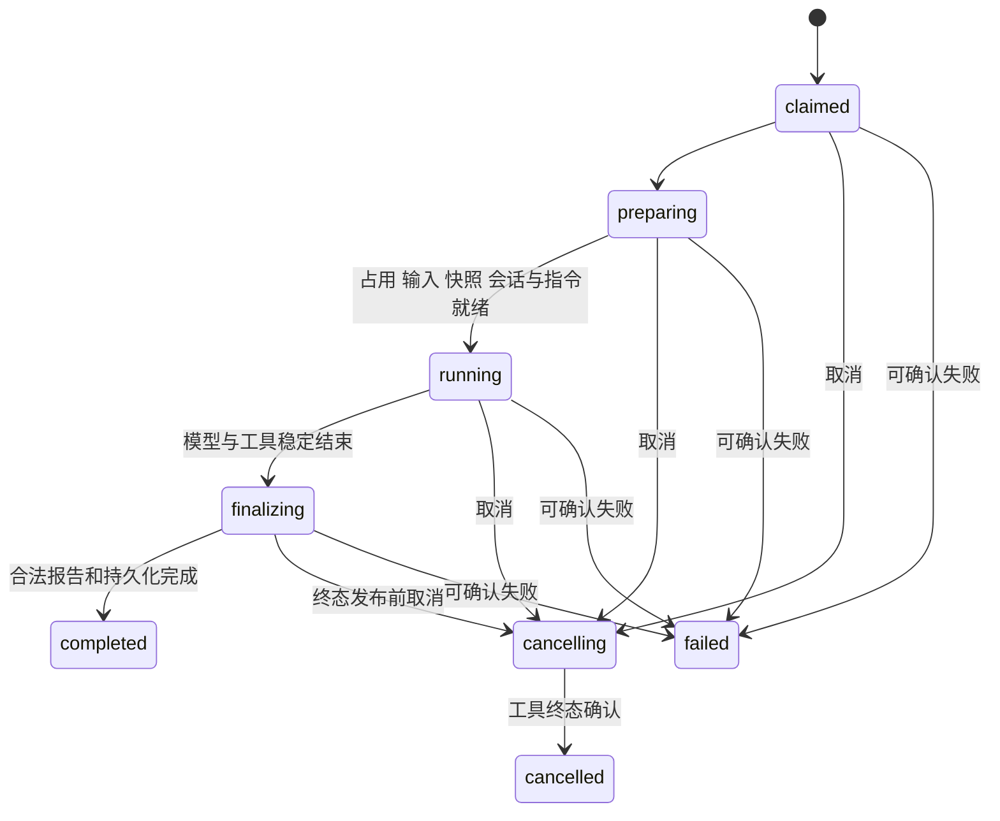

# Knit 状态与转移

本文定义首版需要持久化的业务状态和执行协议；架构见 [ARCHITECTURE.md](ARCHITECTURE.md)，操作细则见 [OPERATIONS.md](OPERATIONS.md)。当前均为待实现设计。元数据的文件／SQLite 物理布局由 M0 对比决定，不改变这里的权威与守卫。

## 1. 状态边界

首版围绕下列对象实现，不为每个观察值建立独立状态机。

| 对象 | 权威与职责 | 状态／判断 |
| --- | --- | --- |
| Task | Git 项目中的 task.md | status、phase、outcome、branch |
| run | 一次 worker 尝试的请求与执行回执 | 启动、准备、执行、取消及终态 |
| Session 引用 | 本机索引及所属客户端的原生记录 | opening/available/missing/incompatible |
| 检查凭据 | 核心发布的 scope/check 证据，绑定只存引用 | 当前资格由输入及成果版本推导 |
| 规范候选 | standards.md 和匹配的审阅回执 | 是否需要提示及本次处理决定 |
| 确定性操作 | 核心操作意图、步骤及实际效果 | planned/running/needs_attention/completed/abandoned |

初始化、快照、占用和兼容性属于执行协议，保留必要结果，不另做产品工作流。桥接监听器和模块实例只是实现资源，不进入持久状态契约。开发者模式是输出开关，也不增加业务状态。

原始证据发布后不改；unknown、stale、suspect 等是观察，不得据此伪写成功或失败。模型判断语义与授权，核心校验身份、摘要、版本和实际效果。

## 2. 初始化与准备

init 清单使用 preparing/ready/failed，无清单表示尚未初始化。只读检查不修改状态；开始写入前保存文件计划，项目资料只补缺，受管代码按旧基线更新，冲突保留人工内容。所有必需项核实后才 ready；失败重试先核对已生效步骤。

ready 不等于每条命令前置条件满足。非 Git 项目可 init；正式代码阶段和提交仍要求有效 HEAD、分支及干净的 Git 操作状态。未知较新版本只读诊断，不猜迁移。

快照 preparing → ready 或 failed。可信 worker 程序可以先启动、取得占用并准备快照；正式 implement 只有快照 ready 后才调用阶段模型／开始写代码。不做 CLI 到 worker 的执行锁交接。

## 3. Task 与输入变更

open 时无 outcome；closed 必有 completed/cancelled/superseded。closed/completed 的 phase 为 deliver；取消／替代保留停止位置。业务结束与 Git 收尾分别判断。

| 事件／入口 | 守卫 | 转移与效果 |
| --- | --- | --- |
| TaskCreated：task new | 用户授权、身份唯一 | open/discuss，不自动实施 |
| DiscussionConfirmed：task ready | 主 Agent 确认目标、条件与资料齐备 | discuss → implement，保存确认输入引用 |
| InputsUpdated：task update --kind clarify | 原目标、条件和范围不变，主 Agent 提供说明 | 保持 phase；有效摘要变化则检查 stale，不自动重跑 |
| InputsUpdated：task update --kind change | 新增、删除或改变目标、条件、范围、业务约束 | 回 open/discuss，清 completed，旧检查失资格 |
| InputsUpdateProposed：运行中 update | 已有活动 run，不改其冻结输入 | 保存 kind、理由、预期原摘要和拟修改内容，待工具终态后应用 |
| RecordWritten：task record | 只改记录、未封存、短锁内核对版本 | 不改有效输入或 phase，不使检查失效 |
| ImplementationAccepted | execution 报告及实际成果有效 | implement → check，累积 scope |
| CheckAccepted | 最新获准检查及目标版本匹配 | pass → deliver；changes_requested → implement；blocked 保留 check |
| RecheckRequested：run check --task | 当前为 check/deliver 或未归档 completed，相关收尾已处理 | open/check，保留范围，不重聊需求；获准检查时更新最新候选 |
| BusinessClosed：deliver 或 task close | 正常完成须有效检查及主 Agent 完成判断 | closed/completed/deliver，Git 收尾另看回执 |
| TaskEndRequested：task close | 明确取消／替代，先停活动工具并核实效果 | closed 及相应 outcome，不默认提交部分源码 |

clarify 包括解释原要求、纠正表述、补充定位或验证资料；新增引用若带来新约束则应为 change。核心不做自然语言分类，主 Agent 负责声明与理由。规范化后的有效摘要未变时不使检查 stale；clarify 不重置修复计数。

clarify 保持 deliver 时也不能据 stale 检查提交；显式 run check 触发复查入口。未归档 completed 发生有效输入变更须回 open 并清 completed，clarify 仍保留 deliver 位置。已完整归档的资料维护不自动重开任务。

待应用变更在旧工具终态后按原 kind 应用；前后版本不匹配先核对。未应用或未明确撤回时阻止后续代码阶段与交付，当前 run 仍按冻结旧范围运行。记录中出现的新要求应经 update 应用，不能偷变 worker 指令。

adopt 不创建或切换分支。无活动／未知 run、未核实 Git 效果且输入一致时：discuss/implement 保持，check 待复查，deliver 回 open/check 并清 completed。原 Session 保留，恢复核实新分支上下文。取消／替代只接管收尾，完整归档不自动重开。

## 4. 自动修复计数

binding 只保存 repairCycleId、repairRounds、stopReason，不建立独立链文件或 active/paused/finished 状态机。新授权周期计数为 0；开始修复轮时累计，重复通知与内部 retry 不重复计数，普通 resume 不重置。

达到项目上限、用户暂停或真实阻塞时写 stopReason，主 Agent 不自动续跑。用户明确开启新修复周期或确认新范围后才分配新 ID；clarify 不构成重置理由。取消旧 run 只影响其对应周期，不能暂停后来新开的周期。

## 5. run 启动与执行

run 只代表 worker 执行，正式阶段为 implement/check，discuss/deliver 的独立建议由 assist 创建 advisory run。context 和确定性 deliver 不创建 run。

准备入口先持久化 run ID／owner token 并把 ID 返回调用方；桥接确认拿到 ID 后才允许执行。准备尚未确认时不调用模型、不改项目业务文件、不做 Git 收尾。CLI 表面仍为一条 run 命令，内部复用 prepare/start；准备中断只留下可查询、可明确放弃的未启动意图。重发 start 按同 ID 认领，不产生第二个实例。

launch 使用 planned/starting/confirmed/failed。starting 响应丢失先查匹配的 claim 和实例，不重启；无法证明有无旧运行时显示 unknown。OS 进程已启动不等于 Agent 已开始。worker 自行取得执行占用，重新核实预期输入，冻结 inputs 并完成必要准备。

Pi 的 agent_end 可能位于自动重试之间，不能独作终态；以公开 prompt 完成／agent_settled 及真实工具终态为边界。result 先持久化，state 再收敛，均由 worker 写，终态不覆写。check 的 changes_requested 可是执行 completed；advisory 完成不推进 Task。

崩溃后核心在 reconcile 操作中记录核实结论，不能伪造 completed 报告。正常结果按固定 acceptanceOperationId 幂等接收。结果已有而业务写回未完成时显示“执行已结束、状态待同步”，先恢复接收，不重复实施。

status 展示总耗时、最近模型／工具活动距今多久以及心跳情况。心跳和诊断事件不算业务活动；有输出不等于有进展，无输出不等于卡死。首版不做语义空转检测、自动取消或总时长停止。

## 6. 对象级取消

首版仅支持 cancel --run 和 cancel --operation，不设请求级取消路由。执行前已有目标 ID；桥接明确执行取消时持久化对象意图，不先杀掉调用进程。普通 CLI --wait 退出与单独观察取消只停止观察。

run 以 runId 和 owner token 固定目标；新恢复使用新 run ID。重复取消返回同一结果，旧取消不影响新 run。取消与终态发布在同一短临界区裁定，不比较 mtime；先发布终态则返回已结束，先登记取消则停止新调用并等待已知工具终态。30 秒宽限后仅显示待确认，保留占用。

确定性操作先有 operation ID 与本次执行 token。取消停止未开始步骤，核实在途 Git／文件效果后进入 needs_attention（reason=cancelled）；不自动撤销 commit/move，也不改变 Task outcome。恢复同操作取得新执行 token，迟到取消不作用于新尝试。意图已转达不等于目标已停止。

## 7. Session 与活动选择

| 状态 | 含义 |
| --- | --- |
| opening | 本次打开／创建尚在准备，不能宣称可恢复 |
| available | 原生归属、引用和必要持久性已核实 |
| missing | 曾有可恢复记录，当前缺失或不可读取，保留引用及原因 |
| incompatible | 客户端、版本、角色或身份不匹配，不交另一客户端解释 |

创建未完成或尚未落盘的具体原因记录在本次 run 准备结果中，不再新增 Session 状态。失败尝试不覆盖旧可用阶段引用，不伪造消息触发原生保存。dispose 不删除原生历史。实施与检查不可复用活跃主会话文件。

恢复先核实旧工具结束，再取跨项目稳定的 Session 执行占用，由原客户端加载。明确新建使用新 Session 并保留来源关系，默认配置变化不改变旧记录归属。

活动选择由当前原生有效路径最后一个匹配项目的选择事件决定，taskId=null 清除；索引只作快照，不能复活早期选择。追加后响应丢失按 operationId 查已写条目。树切换重新核实，不清掉后来选择的别的任务。后台结果只提醒匹配原发起会话／路径，监听器关闭不取消 worker。

## 8. 检查资格

最新获准检查的 lastCheckRunId 是唯一候选；仅被忙拒绝的请求不算开始，已接纳后的准备／执行失败不回退旧 pass。

| 事实 | 当前资格 |
| --- | --- |
| 无凭据或缺范围 | missing，补足范围并检查 |
| 最新检查尚未结束 | pending，不能借更早 pass 收尾 |
| pass 且身份／输入／成果版本匹配 | valid |
| changes_requested、blocked 或必需证据缺失 | blocked |
| clarify/change、生效规则、成果、分支或 restore 影响选定目标 | stale，复查 |
| 纯记录、运行引用、未生效候选、等价改名／归档移动 | 不变 |

检查证据不等于全部自然语言要求已完成。必需人工验收由主 Agent 按用户要求核对、写入任务记录并据实际确认继续，首版不提供独立人工门槛命令／字段；技术报告不能替用户确认。

scope 按 Task 累积，恢复新起点不清空旧成果。规范为授权输出时，冻结旧输入与新产物分开，新规则是否追用于本任务由主 Agent 明确。工作提交后对选定 commit 核实，不把后来工作区新变动算已交付。跨机缺凭据时不猜通过；Git 中已结束的归档只显示历史，不自动重开。

## 9. 规范候选

无候选无需新增；有 standards.md 而无匹配审阅回执则机械提示。回执匹配 Task、分支与候选摘要时可继续，决定为 applied/deferred/rejected/mixed。延期／拒绝有理由即可，不强制新规则生效；候选或分支变化重新提示。

采纳需核实正式规范正文与索引。正式规则修改取得执行占用，其影响按输入／检查规则处理；历史审阅和已归档事实不撤销。

## 10. 确定性操作与恢复

操作 planned → running → completed；冲突、失败、取消或未知效果进入 needs_attention，核实后恢复。只有明确撤回且没有未知效果才 abandoned；completed/abandoned 不改回运行中。步骤保留尝试与已核验证据。

| 实际效果 | 恢复行为 |
| --- | --- |
| 仍为 before | 可执行原授权步骤 |
| 已为 after | 补检查点，跳过重复效果 |
| 前后均不匹配 | 保留现场，needs_attention |
| 进程或 Git 效果未知 | 先核实，不重试或假放弃 |

SQLite 若入选，可把关联元数据置于短事务；Git、Markdown 和原生历史效果仍逐步核验。事务／短锁不跨模型调用、工具等待或 hooks。记录／选择冲突只影响相关对象，输入或未核实 Git 效果阻相关后续代码及交付。

## 11. 收尾与封存

正常完成调用 deliver；archive 只处理可归档资料或继续已有归档，不能绕过正常交付条件；task close 只记业务结束。

| 步骤 | 完成证据 |
| --- | --- |
| preflight | 绑定分支及提交授权明确、工具终态、候选已处理；正常完成另需有效检查与主 Agent 完成判断 |
| work_commit | 限定候选路径与目标树，核实真实 OID、范围与 index 保护；无需工作提交则跳过并记原因 |
| prepare_archive | 完整结果、验证、工作提交和结束结果进入记录 |
| seal_archive | 短锁内捕捉记录版本、目录与首次归档月份 |
| move_task | ID、目标和文件指纹匹配 |
| archive_commit | 本任务路径及明确引用的真实提交，不能写自身哈希反复提交 |
| finalize | 关联和定位收妥，条件清选择，操作 completed |

main／默认分支不隐含提交许可。已有明确授权或用户认可的项目策略覆盖当前分支时不重复确认；adopt 的继续意图不自动授权提交。

封存期间 task record 返回未保存（sealed），不写任务、不自动转存、不制造未提交修改。主 Agent 不得汇报已记录；封存结束后按原记录意图重试，作为档案的新资料修改，明确其未包含在原归档提交，是否提交按已有授权。此补记不重开任务，也不篡改旧交付回执。

需改业务目标时先暂停收尾。未移动且工具已结束时可明确解除封存后重新准备；已移动或结果未知先核实与修复，不自动 reset。

取消／替代仅归档实际资料，不要求未完成代码检查成 pass，不默认提交部分源码，不造空 commit。重试沿同一操作及首次目标，结果分别报告工作提交、移动、归档提交和待办。

## 12. 占用与兼容性

本地 mkdir 锁／进程身份与 owner token 规则见 OPERATIONS；心跳可疑只调查，未知工具不放行新代码阶段。强解是显式风险操作，不是机器终态证明。旧 token 不能写回；Session 键不随项目改变。

restore 默认预览，执行核对当前指纹、范围和终态。Task 输入经 update 恢复并保留记录，runtime 和原生 Session 不由普通源码 restore 覆盖；真实恢复使旧检查不再适用于新目标。未知版本只读报告，首版无自动 gc。

## 13. 入口与验证范围

context 提供讨论输入；task ready 推进讨论确认；task update 显式声明 clarify/change；run implement/check 派发或复查；assist 只给建议；deliver、archive、task close 职责分别处理；cancel 仅指明确对象；resume --run 新尝试，resume --operation 先核实已有效果。status/doctor/storage 不推进业务。

测试按不变量和副作用选择：

- 只读查询和内存资源做必要的正常／错误验证，不套持久恢复矩阵。
- 输入、阶段接收和计数覆盖分类、版本冲突、重复接收与相关中断。
- 启动／取消覆盖实例不明、工具终态、完成竞争与旧 token。
- Git／文件移动在关键效果前后注入崩溃，验证无重复提交、无无关 index／文件损失。
- 开发者模式验证脱敏、业务结果等价及输出通道，不为诊断事件再建一套状态测试。

归属及里程碑见 DESIGN 第 16 节。M2 的数据保护测试不能推迟到发布阶段。
